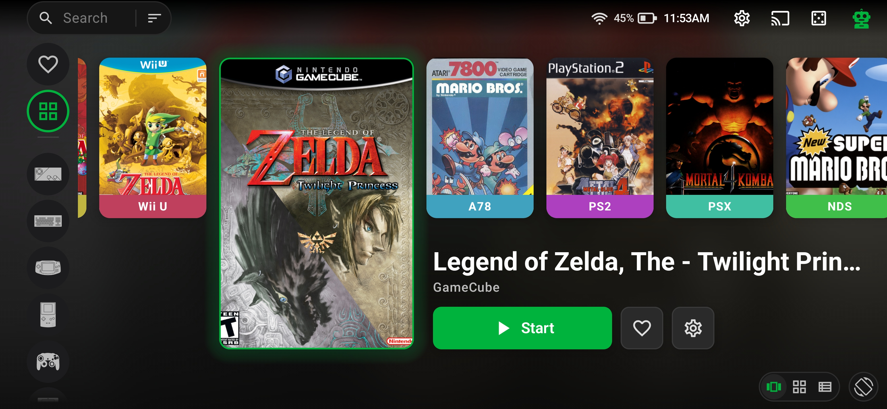
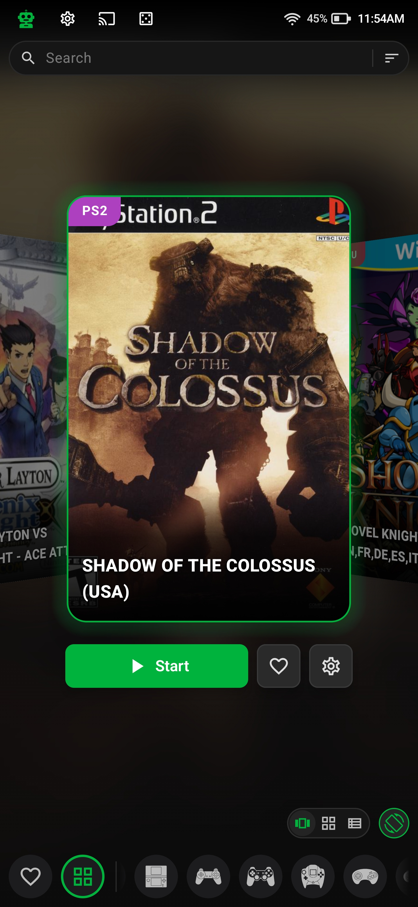
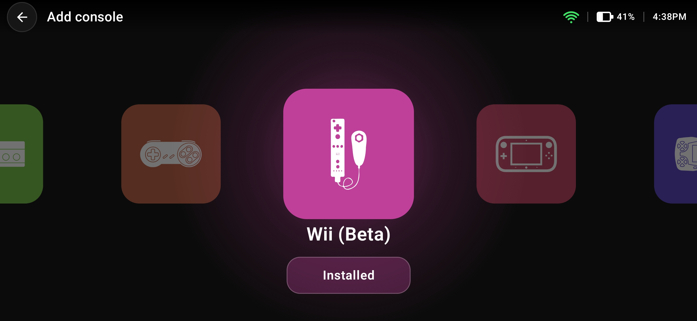
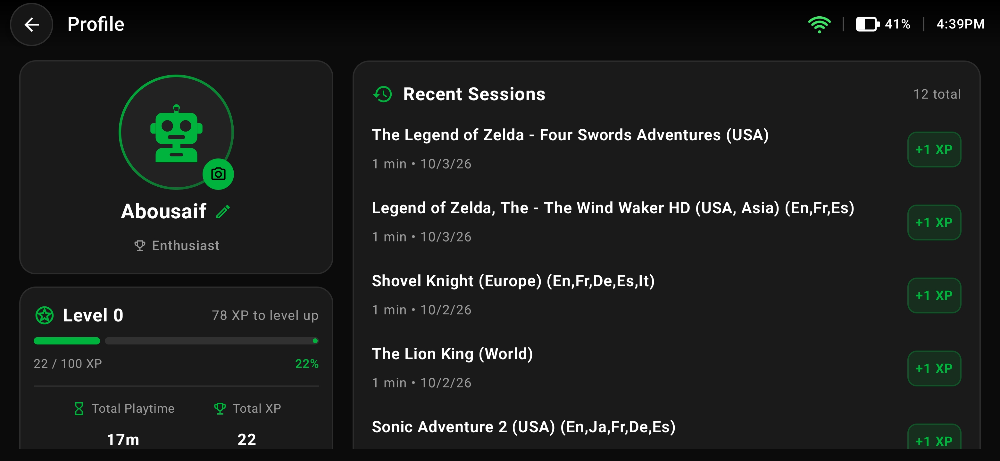

# Omnidroid

<p align="center">
  <a href="https://github.com/Ahmed-Abousaif/Omnidroid/releases"></a>
  <a href="https://github.com/Ahmed-Abousaif/Omnidroid/stargazers"></a>
  <a href="https://github.com/Ahmed-Abousaif/Omnidroid/blob/master/COPYING"></a>
  <a href="https://github.com/Ahmed-Abousaif/omni-libretrodroid"></a>
</p>

<p align="center">
  <strong>Omnidroid</strong> is a modern, landscape-first, Libretro-powered multi-console emulation platform for Android. Forked from <a href="https://github.com/Swordfish90/Lemuroid">Lemuroid</a>, Omnidroid elevates mobile and handheld gaming with native <strong>Vulkan hardware acceleration</strong>, complete <strong>controller-first navigation</strong>, multi-provider <strong>cloud saves</strong>, and a built-in <strong>gamer profile & XP progression system</strong> — all packaged into a lightweight release (&lt;8.5 MB APK).
</p>

<p align="center">
  <a href="#-support-omnidroid"><b>Support</b></a> •
  <a href="#-screenshots"><b>Screenshots</b></a> •
  <a href="#-for-players-getting-started"><b>For Players</b></a> •
  <a href="#-supported-consoles--systems"><b>Supported Systems</b></a> •
  <a href="#-omnidroid-padkit"><b>PadKit</b></a> •
  <a href="#-features-deep-dive"><b>Features</b></a> •
  <a href="#-for-contributors--developers"><b>For Contributors</b></a> •
  <a href="#star-history"><b>Star History</b></a>
</p>

---

## ☕ Support Omnidroid

If Omnidroid helps you play, you can fuel continued development here:

<p align="center">
  <a href="https://www.buymeacoffee.com/abousaif"></a>
  &nbsp;&nbsp;&nbsp;&nbsp;
  <a href="https://ko-fi.com/abousaif"></a>
</p>

---

## 📸 Screenshots

<p align="center">
  
</p>
<p align="center">
  <em>Landscape console view with cover artwork, full game details, and quick play actions</em>
</p>

<table align="center" width="100%">
  <tr>
    <td width="31.8%" rowspan="2" align="center" valign="middle">
      <br />
      <b>Portrait Console Carousel</b><br />
      <sub>Interactive cover flow carousel, quick Continue & live search</sub>
    </td>
    <td width="68.2%" align="center" valign="middle">
      <br />
      <b>Console Carousel</b><br />
      <sub>On-demand Libretro cores & database slice downloads</sub>
    </td>
  </tr>
  <tr>
    <td width="68.2%" align="center" valign="middle">
      <br />
      <b>Gamer Profile & Stats</b><br />
      <sub>Track play hours, daily streaks, XP leveling & session history</sub>
    </td>
  </tr>
</table>

---

## ⚡ Highlights

- 🌋 **Native Vulkan & OpenGL ES Engine:** Powered by our custom [omni-libretrodroid](https://github.com/Ahmed-Abousaif/omni-libretrodroid) native C++ engine with per-system graphics API switching (Vulkan, GLES 2/3, Software) for rock-solid 60 FPS performance and reduced thermal throttling.
- 🎮 **Controller-First Navigation:** Seamless navigation across the entire app (library, search, consoles, settings, game pages) using physical gamepads with focus glow and button hint bars.
- 📱 **Handheld & Phone UI:** Fluid landscape and portrait modes with dedicated layouts for handhelds (Retroid, Odin, ANBERNIC), phones, tablets, and Android TV.
- ☀️ **Light & Dark Themes:** Switch between dark and light mode in Display settings — library, settings, profile, and game menus follow a cool gray chrome theme; in-game view and gamepad binding stay dark for play focus.
- 🚀 **Frontend & File Manager Integration:** Exported launcher activity for external frontends (Daijishō, Pegasus, Beacon) and direct "Open With" file manager launching for ROMs and archives without requiring a prior library scan.
- 📚 **Console Carousel & Library Sorting:** Dedicated console views with a portrait cover carousel, landscape details pane, flexible sorting (name, console, recently played, favorites), and random game selection.
- 🔄 **Saves Backup & Lemuroid Migration:** Multi-tier save and state migration from Lemuroid (automatic 1-tap direct migration, uncompressed folder import via SAF, and lenient ZIP backup import), plus multi-provider cloud sync (**Google Drive**, **Dropbox**, **OneDrive**) with full conflict resolution.
- 🏆 **Gamification & Profile System:** Earn XP from play sessions, maintain daily streaks, level up, and unlock collection badges (Collector → Enthusiast → Historian → Omnidroid Master). Browse day-grouped sessions with game-detail shortcuts and a compact console grid in separate tabs, with a dedicated profile rail in landscape.
- 📺 **Android TV & Big-Screen Integration:** Full Android TV Leanback launcher support with dynamic home screen preview channels for recently played games, plus wireless and HDMI casting.
- 🔋 **Battery-Aware HD Mode:** Intelligently disables heavy HD enhancements when battery drops below 15% to conserve power.
- 🛡️ **Lightweight & 16KB Page-Aligned:** Universal release APK is under 8.5 MB (~27% smaller than baseline) and fully aligned for Android 15+ 16KB memory page sizes.

---

## 🎮 For Players: Getting Started

### 1. Installation

Download the latest APK from the [Releases](https://github.com/Ahmed-Abousaif/Omnidroid/releases) page and install it on your Android device (Android 7.0+ / API 24+ required).

### 2. Adding ROMs

1. Launch Omnidroid and grant storage permissions when prompted.
2. Select the directory where your game ROMs are stored.
3. Omnidroid's **content-based ROM scanner** automatically identifies your games from file headers (no strict folder structure required).
4. Supported compression formats include `.zip`, `.7z`, and `.chd`.

### 3. BIOS & Decryption Keys

Most retro consoles run immediately without external BIOS files. For systems that require BIOS dumps or decryption keys:

- **Nintendo Switch (Eden):** Requires `prod.keys` and supports optional System Firmware for games that require system applets or fonts (import via Settings → BIOS/Keys or place in your Switch storage directory).
- **PlayStation 2 (ARMSX2):** Compatible with USA, Europe, and Japan BIOS images.
- Other BIOS files (e.g., PS1, Sega CD, GBA) can be placed in the standard Libretro system folder.

### 4. Controller Setup

- **Physical Gamepads:** Plug in via USB or pair via Bluetooth (Xbox, PlayStation DualShock/DualSense, Nintendo Switch Pro, 8BitDo, and integrated handheld controls). Key mappings are applied automatically.
- **Touch Controls:** On-screen virtual pads can be customized for size, position, opacity, and 4-way vs. 8-way D-Pad modes. Retro systems support routing the virtual analog stick to D-Pad inputs.

### 5. Saves, Backup & Lemuroid Migration

Under **Settings → Saves & Backup**:
- **Migrate from Lemuroid:** Move your battery saves (`.srm`) and save states (`.state`) seamlessly. If Lemuroid is detected on your device (Android ≤10, gaming handhelds, rooted devices), tap **Migrate from Lemuroid** for instant 1-tap migration. On Android 11+, use **Import from folder** or copy via PC USB using the in-app guide.
- **Backup & Folder Import:** Import uncompressed save folders from SD cards or external storage, or export/import a local `.zip` backup.
- **Cloud Saves (Play Build):** Connect **Google Drive**, **Dropbox**, or **OneDrive** for automatic cross-device synchronization and conflict management.

---

## 🕹️ Supported Consoles & Systems

Omnidroid supports a massive range of retro and modern consoles powered by Libretro cores:

| System                             | Console / Generation     | Emulation Core                                                                                                                                                      |
| :--------------------------------- | :----------------------- | :------------------------------------------------------------------------------------------------------------------------------------------------------------------ |
| **Nintendo Switch** _(Beta)_      | Hybrid Console (8th Gen) | [Eden](https://github.com/eden-emulator/eden)                                                                                                                       |
| **Nintendo 3DS**                   | Handheld (8th Gen)       | [Azahar](https://github.com/azahar-emu/azahar) / [Citra](https://docs.libretro.com/library/citra/)                                                                  |
| **Nintendo Wii U** _(Beta)_        | Home Console (8th Gen)   | [Cemu](https://github.com/cemu-project/Cemu)                                                                                                                        |
| **Nintendo Wii** _(Beta)_          | Home Console (7th Gen)   | [Dolphin](https://docs.libretro.com/library/dolphin/)                                                                                                               |
| **Nintendo GameCube**              | Home Console (6th Gen)   | [Dolphin](https://docs.libretro.com/library/dolphin/)                                                                                                               |
| **Nintendo DS (NDS)**              | Handheld (7th Gen)       | [melonDS DS](https://github.com/JesseTG/melonds-ds)                                                                                                                 |
| **Nintendo 64 (N64)**              | Home Console (5th Gen)   | [mupen64plus](https://docs.libretro.com/library/mupen64plus/)                                                                                                       |
| **Game Boy Advance (GBA)**         | Handheld (6th Gen)       | [mgba](https://docs.libretro.com/library/mgba/)                                                                                                                     |
| **Game Boy / Color (GB/GBC)**      | Handheld (4th/5th Gen)   | [gambatte](https://docs.libretro.com/library/gambatte/)                                                                                                             |
| **Super Nintendo (SNES)**          | Home Console (4th Gen)   | [snes9x](https://docs.libretro.com/library/snes9x/)                                                                                                                 |
| **NES / Famicom**                  | Home Console (3rd Gen)   | [fceumm](https://docs.libretro.com/library/fceumm/)                                                                                                                 |
| **PlayStation 2 (PS2)** _(Beta)_   | Home Console (6th Gen)   | [ARMSX2](https://github.com/Ahmed-Abousaif/ARMSX2)                                                                                                                  |
| **PlayStation Portable (PSP)**     | Handheld (7th Gen)       | [ppsspp](https://docs.libretro.com/library/ppsspp/)                                                                                                                 |
| **PlayStation (PSX)**              | Home Console (5th Gen)   | [PCSX-ReARMed](https://docs.libretro.com/library/pcsx_rearmed/)                                                                                                     |
| **Sega Dreamcast**                 | Home Console (6th Gen)   | [flycast](https://docs.libretro.com/library/flycast/)                                                                                                               |
| **Sega Genesis / Mega Drive**      | Home Console (4th Gen)   | [genesis_plus_gx](https://docs.libretro.com/library/genesis_plus_gx/)                                                                                               |
| **Sega CD / Mega CD**              | Add-on (4th Gen)         | [genesis_plus_gx](https://docs.libretro.com/library/genesis_plus_gx/)                                                                                               |
| **Sega Master System / Game Gear** | 8-bit Console & Handheld | [genesis_plus_gx](https://docs.libretro.com/library/genesis_plus_gx/)                                                                                               |
| **Arcade**                         | Classic Coin-Op Arcade   | [FBNeo](https://github.com/libretro/FBNeo/)                                                                                                                         |
| **PC Engine / TurboGrafx-16**      | Home Console (4th Gen)   | [beetle_pce_fast](https://docs.libretro.com/library/beetle_pce_fast/)                                                                                               |
| **Neo Geo Pocket / Color**         | Handheld (5th/6th Gen)   | [mednafen_ngp](https://docs.libretro.com/library/beetle_neopop/)                                                                                                    |
| **WonderSwan / Color**             | Handheld (5th/6th Gen)   | [beetle_cygne](https://docs.libretro.com/library/beetle_cygne/)                                                                                                     |
| **Atari 2600 / 7800 / Lynx**       | Classic Atari Family     | [stella](https://docs.libretro.com/library/stella/) / [prosystem](https://docs.libretro.com/library/prosystem/) / [handy](https://docs.libretro.com/library/handy/) |

---

## 🎮 Omnidroid PadKit

Our touch controls use [Omnidroid PadKit](https://github.com/Ahmed-Abousaif/Omnidroid-padkit/blob/da4a1c12a69eeb744217624c4ee7496b07a12700/README.md), an Android-only fork of PadKit compiled directly from the pinned submodule. It preserves Android **7.0 / API 24** support, customizable button/stick visuals, multi-touch, radial layouts, composite buttons, and double-tap stick clicks.

The fork adds reliable releases during cancellation, removal, remapping, and disposal; immediate tilt/simulation overrides; adjustable Android haptics; grid-layout helpers; and analog-style D-pads that honor four/eight-way settings and dead zones while held.

Performance work reduces allocation and repeated work in the touch path:

- Pointer capture uses an owner index and reusable routing buffers; unchanged handlers, capture sets, and simulated state skip redundant processing.
- Face controls reuse pressed-key storage and cache immutable contributions. Event and haptic generation share allocation-light state diffs.
- Analog thumbs read movement state during placement, avoiding recomposition just to move the thumb. Face layouts remember their immutable anchor/key lists.
- In the latest warmed host replay, held face-button updates allocated **65–68% fewer bytes**, changing three-finger selections allocated **37% fewer**, and mixed routing through 12 controls allocated **29% fewer**. An earlier, separate routing pass reduced allocations by **66–72%** in its two/five/ten-pointer replays.

These measurements use different staged baselines and are not additive. They measure host allocations, not Android FPS, touch latency, battery life, or whole-app memory. The latest performance pass adds 890 bytes to the unshrunk library AAR in exchange for reusable storage and lower allocation churn. See the [full changes and measurement method](https://github.com/Ahmed-Abousaif/Omnidroid-padkit/blob/da4a1c12a69eeb744217624c4ee7496b07a12700/README.md#changes-from-the-original-padkit).

The library has **114 passing tests**, including **24 API 24 cases**, plus five Omnidroid tilt tests. Its release packaging, Android API lint, and Omnidroid release R8 checks pass. Library mechanics live in PadKit; skins, preferences, sensors, console placement, and emulator routing remain in Omnidroid.

---

## 🔍 Features Deep Dive

<details>
<summary><b>🌋 Vulkan Hardware Acceleration & Graphics API Selection</b></summary>
<br>

- **Custom Native Engine:** Built on our custom `omni-libretrodroid` engine, offering native Vulkan hardware acceleration alongside OpenGL ES 2.0/3.0+ and Software rendering.
- **Per-System API Switching:** Configure Graphics API globally or per console (**Auto**, **Vulkan**, **OpenGL**, **Software**) directly from Settings.
- **Low Overhead:** Drastically lowers CPU draw-call bottlenecks on modern mobile GPUs (Adreno, Mali, Immortalis), maintaining a smooth 60 FPS in demanding cores.
</details>

<details>
<summary><b>📱 Handheld-First Launcher & UI Customization</b></summary>
<br>

- **Console Carousel & Details View:** Portrait mode offers an interactive cover flow carousel, while landscape mode features a side-by-side view with cover art, release metadata, and instant play actions.
- **Library Sorting & Random Play:** Sort by title, console, recently played, or favorites, plus a random game button for spontaneous gaming.
- **Three Library Views:** Choose the Console carousel, zoomable Grid, or compact List in portrait and landscape. Grid and List share a renderer with bounded paging and covers decoded at their displayed size for efficient browsing of large libraries.
- **Landscape Navigation:** Dedicated sidebar for quick navigation between All Games, Favorites, and specific consoles, showing uncropped covers and titles.
- **Startup Screen Selector:** Choose what Omnidroid opens to on launch (All Games, Favorites, or a favorite console).
- **Light & Dark Mode:** Theme preference under Display settings applies instantly across library chrome, settings, profile, dialogs, and game menus (in-game view and gamepad screens remain dark).
- **Consistent Side Menus:** The in-game menu and library Game settings share panel styling, transitions, nested pages, and controller navigation. Cover and name actions are grouped under Appearance.
- **Home Screen Launcher:** Set Omnidroid as your Android device's default launcher for a dedicated console feel.
- **System Telemetry:** Live on-screen battery percentage, Wi-Fi/mobile network status, and connected gamepads right on the top bar.
</details>

<details>
<summary><b>🚀 External Frontends & File Manager Launching</b></summary>
<br>

- **Frontend Launcher Contract:** Boot games directly from external launchers like Daijishō, Pegasus, and Beacon using `ExternalGameLauncherActivity` with standard Android `ACTION_VIEW` intents.
- **"Open With" File Manager Support:** Tap any supported ROM or zipped archive in your Android file manager to boot directly into the game without requiring a prior library scan.
- **Clean Return on Exit:** Quitting an externally launched game returns focus directly to the calling frontend without leaving stale tasks on your recent apps overview.
</details>

<details>
<summary><b>📺 Android TV Home Screen & Leanback Support</b></summary>
<br>

- **Leanback Launcher:** Native Android TV home screen banner and D-pad optimized navigation designed for a 10-foot couch experience.
- **Home Screen Channels:** Automatically publishes a dynamic "Omnidroid" recommendations row on the Android TV home screen displaying recently played games.
- **Direct Resume:** Click any game tile directly from your TV home screen to resume playing immediately.
</details>

<details>
<summary><b>🎮 Nintendo Switch Emulation (Eden Core)</b></summary>
<br>

- **Eden Core Architecture:** Powered by the dedicated Eden backend, delivering 64-bit ARM emulation with high-performance Vulkan graphics acceleration for smooth handheld and mobile gameplay.
- **Broad Format Support:** Out-of-the-box detection and execution for Nintendo Switch packages (`.nsp`, `.xci`, `.nca`, and `.nro`).
- **Direct Embedded Cover Extraction:** Automatic background icon extractor extracts high-resolution official game artwork straight from ROM packages into the library cache without requiring external network lookups.
- **Complete Controller Mapping:** Native Pro Controller / Joy-Con layout with clickable dual analog sticks (L3/R3), D-pad, shoulder buttons and analog triggers (L/R/ZL/ZR), and system buttons (+, -, Home, Capture).
- **On-Demand Dynamic Delivery:** Packaged as an isolated dynamic feature module, keeping the base APK installation lightweight and downloading core binaries only when needed.
</details>

<details>
<summary><b>🕹️ Dual-Screen Layouts (Nintendo 3DS & DS)</b></summary>
<br>

- **Flexible Screen Configurations:** Default Top-Bottom, Side-by-Side (Left-Right), or Single Screen (Top or Bottom).
- **Quick Screen Toggle:** Tap the on-screen layout button to instantly toggle between dual-screen and single top-screen without opening menus.
- **True Stylus Multi-Touch:** Bottom touch screen supports simultaneous multi-touch input, allowing you to use the stylus overlay while holding virtual buttons.
- **Hide Pads Mode:** Tap the pad toggle to slide virtual controls away for stylus-heavy gameplay; tap the edge tab to bring them back.
</details>

<details>
<summary><b>🐬 GameCube & Wii Emulation (Dolphin Core)</b></summary>
<br>

- **Automated Sys Asset Provisioning:** Essential Dolphin `Sys/` assets (game database, system fonts, DSP binary engines) are downloaded automatically on first launch.
- **Adaptive Internal Resolution Scaling:** 1x Native (640×528), 2x (720p), 3x (1080p), and 4x (1440p / QHD) with dynamic intermediate framebuffer reallocation.
- **Versatile Controller Profiles:** Native GameCube controller, Sideways Wiimote (for 2D platformers), Wiimote + Nunchuk (for 3D adventures), and Wii Classic Controller.
- **Ghost Controller Prevention:** Automatically disconnects unused controller ports to prevent false multiplayer detections in games like _Super Smash Bros. Melee_.
</details>

<details>
<summary><b>⚡ PlayStation 2 & Wii U Emulation</b></summary>
<br>

- **PlayStation 2 (ARMSX2):** PCSX2-derived 64-bit ARM core with Vulkan, OpenGL, and Software rendering pipelines. Features dedicated DualShock 2 touch layout with dual analog sticks, rumble support, and automatic BIOS verification.
- **Nintendo Wii U (Cemu):** Vulkan-accelerated 64-bit ARM core with Multi-Core Recompiler support, interactive touch GamePad view, and side-by-side TV/GamePad rendering.
</details>


<details>
<summary><b>📊 Device Profile & Hardware Benchmarking</b></summary>
<br>

- Under **Settings → Advanced → Device profile**, view detailed hardware specs: SoC, RAM, CPU cores/frequencies, GPU / OpenGL ES, and Vulkan driver versions.
- Built-in 30-second CPU benchmark measures emulation throughput in ops/s.
</details>

<details>
<summary><b>💾 Saves, Backup & Lemuroid Migration</b></summary>
<br>

- **More Save Slots:** Need more than four? Choose **Save to new slot** in the Save State menu, where supported.
- **Load Your Autosave:** Choose **Autosave** in the Load State menu to return to your saved position.
- **Clear Save Errors:** If saving fails when quitting, you can retry, keep playing, or quit without saving.
- **Seamless Lemuroid Migration:** 100% format compatibility with Lemuroid and RetroArch saves (`.srm` raw SRAM and `.state` Libretro serialized states).
- **1-Tap Direct Detection:** Automatically detects existing Lemuroid saves in `/sdcard/Android/data/com.swordfish.lemuroid/files/` when accessible, prompting a 1-tap migration with live file counts.
- **Storage Access Framework (SAF) Folder Import:** Select any uncompressed folder on your device, SD card, or USB drive via the system document tree picker.
- **Lenient ZIP Backup Import:** Supports Omnidroid backups, raw Lemuroid dumps, or loose `.srm` files without strict root folder hierarchies.
- **Zero-Loss Conflict Resolution:** Existing files are preserved; differing incoming files are saved with timestamped backups and surfaced in an interactive conflict resolver.
- **Built-in Migration Guide:** In-app walkthrough with step-by-step instructions for PC/USB file transfer and on-device file managers.
</details>

---

## 🛠️ For Contributors & Developers

Start with a public fork and the Free debug variant. UI, input, metadata, documentation, and native-engine changes can be developed separately.

### Repository map

```text
Omnidroid/
├── omnidroid-app/                  # Compose UI, game screens, settings, and app lifecycle
├── omnidroid-app-ext-free/         # GitHub/free distribution services
├── omnidroid-app-ext-play/         # Google Play and cloud-service integrations
├── omnidroid-touchinput/           # Omnidroid control skins, layouts, tilt, and backend routing
├── omnidroid-padkit/               # Builds the pinned PadKit sources with Omnidroid's toolchain
├── modules/padkit/upstream/omnidroid-padkit/   # PadKit submodule
├── modules/switch/upstream/eden/   # Eden source submodule
├── modules/cemu/upstream/cemu-libretro-android/ # Cemu Android/libretro source submodule
├── omni-libretrodroid/             # Native Vulkan/GLES runtime submodule
├── omnidroid-cores/                # Core binaries, build/update tools, and SDL Java sources
├── omnidroid-chd/                  # CHD wrapper; libchdr submodule is under src/main/cpp/
├── omnidroid-metadata-libretro-db/ # Offline identification database and title matching
├── retrograde-app-shared/          # Shared game, database, storage, and lifecycle code
└── retrograde-util/                # Common utilities
```

### Fork and clone

All six direct source submodules and their 13 nested dependencies were checked for anonymous Git access on **16 November 2026**. They use public HTTPS URLs; no private-repository access or maintainer credentials are needed to check out the recorded sources. Forking Omnidroid does not require forking every dependency.

Fork this repository on GitHub, then:

```bash
git clone --recurse-submodules https://github.com/YOUR-USER/Omnidroid.git
cd Omnidroid
git remote add upstream https://github.com/Ahmed-Abousaif/Omnidroid.git
git switch -c fix/your-change
```

For an existing clone, or after switching branches/pulling changes:

```bash
git submodule sync --recursive
git submodule update --init --recursive
git submodule status --recursive
```

A leading `-` in submodule status means a dependency is uninitialized; `+` means its checkout differs from the parent pin. Initial clones include large core binaries and native source trees.

The direct dependencies are:

- `modules/padkit/upstream/omnidroid-padkit`: [Omnidroid-padkit](https://github.com/Ahmed-Abousaif/Omnidroid-padkit).
- `omnidroid-cores`: [OmnidroidCores](https://github.com/Ahmed-Abousaif/OmnidroidCores).
- `omni-libretrodroid`: [omni-libretrodroid](https://github.com/Ahmed-Abousaif/omni-libretrodroid).
- `modules/cemu/upstream/cemu-libretro-android`: [cemu-libretro-android](https://github.com/Ahmed-Abousaif/cemu-libretro-android).
- `modules/switch/upstream/eden`: [Eden](https://git.eden-emu.dev/eden-emu/eden), hosted outside GitHub.
- `omnidroid-chd/src/main/cpp/libchdr`: [libchdr](https://github.com/rtissera/libchdr).

[.gitmodules](.gitmodules) is the authoritative list of URLs and tracked branches. Normal setup checks out committed pins; `--remote` intentionally changes dependency versions and is not part of everyday setup.

### Tools and Android SDK

Use the checked-in Gradle wrapper instead of a system Gradle installation.

- **JDK 17** is the compilation baseline; set `JAVA_HOME` and use a compatible Gradle JDK in Android Studio.
- **Gradle 9.3.1** is selected by [gradle-wrapper.properties](gradle/wrapper/gradle-wrapper.properties).
- Install **Android SDK Platform 37.0**, **Build Tools 36.0.0**, and **Platform Tools**. The app supports Android API 24 and above.
- Set `ANDROID_HOME` to your SDK directory, or let Android Studio create an ignored `local.properties` containing `sdk.dir`.
- APK/native builds also need the NDK, CMake, and host build tools requested by the selected native modules. Kotlin compilation and the input unit tests below do not rebuild emulator engines.

For command-line SDK installation:

```bash
sdkmanager "platforms;android-37.0" "build-tools;36.0.0" "platform-tools"
```

The current Android Gradle Plugin is **9.1.1** with compile SDK **37**; target SDK remains **36** and minimum SDK remains **24 (Android 7.0)**. Kotlin is **2.2.10**, Compose BOM **2026.08.00**, KSP **2.2.10-2.0.2**, and Dagger/Hilt **2.60.1**. Check [build.gradle.kts](build.gradle.kts) and [deps.kt](buildSrc/src/main/java/deps.kt) before changing tool versions.

### First build and useful checks

From the repository root:

```bash
# Fast app source check; no release signing or Play credentials required
./gradlew :omnidroid-app:compileFreeDynamicDebugKotlin

# PadKit release/lint/API 24 regression gate, plus host tilt tests
./gradlew :omnidroid-padkit:verifyAndroid7Compatibility :omnidroid-touchinput:testDebugUnitTest

# Build a debug APK, or install it on a connected device
./gradlew :omnidroid-app:assembleFreeDynamicDebug
./gradlew :omnidroid-app:installFreeDynamicDebug

# Formatting checks for the modules changed by your PR
./gradlew :omnidroid-app:ktlintCheck :omnidroid-touchinput:ktlintCheck
```

On Windows, replace `./gradlew` with `.\gradlew.bat`. Debug APKs are written under `omnidroid-app/build/outputs/apk/`. Use `adb devices` to check the device connection.

There are two flavor dimensions: distribution (`free` / `play`) and core packaging (`dynamic` / `bundle`). Specify a complete variant rather than relying on ambiguous tasks such as `assembleDebug`. Start with `FreeDynamicDebug`; bundled-core and Play release builds have additional packaging/distribution requirements.

Tests under a module's `src/test` run on the host. Tests under `src/androidTest` require a device or emulator. For input changes, also check multi-finger touch, cancellation/backgrounding, tilt transitions, and vibration on hardware.

### Native engines and core updates

Most frontend work uses the recorded native sources and existing core binaries. Native engine development belongs in its submodule:

- **Eden:** use the source selected by the parent pin. Its Android Gradle file specifies the NDK/CMake versions; the CI recipe is [.github/actions/setup-eden/action.yml](.github/actions/setup-eden/action.yml). The pinned-source builder is `python3 omnidroid-cores/update_cores.py --cores switch --eden-ref pinned --eden-jobs 2`; follow that tool's prerequisites before running it.
- **Cemu:** follow the Android/libretro build instructions and workflow in the Cemu fork.
- **Native runtime / CHD:** their Gradle modules invoke the CMake projects under `src/main/cpp`.
- **Other cores / databases:** see the update tools in `omnidroid-cores` and [.github/workflows/cores-update.yml](.github/workflows/cores-update.yml).

A full APK/native build is a separate check from Kotlin compilation. Include the engine, ABI, toolchain, and device details when reporting native-build failures.

### Editing PadKit or another submodule

PadKit sources live at `modules/padkit/upstream/omnidroid-padkit`; `omnidroid-padkit/` is the Android source wrapper, not a second copy of the library. Editing the submodule is immediately reflected in Omnidroid's builds.

PadKit is an Android-only library with built-in Kotlin support. Its library tests live in the submodule, including Compose and haptic cases for API 24. Both its own `:lib:verifyAndroid7Compatibility` task and the parent wrapper's compatibility task build a release AAR, run lint, and execute those tests. See [the optimization implementation](docs/padkit-optimization.md) for the changes and measured limits.

Submodules normally have detached HEADs. Create a branch before editing:

```bash
git -C modules/padkit/upstream/omnidroid-padkit switch -c fix/control-behavior
```

Keep reusable capture, simulation, directional output, and feedback behavior in PadKit. Keep Omnidroid skins, saved preferences, console layouts, host actions, and emulator routing in the app. See [the capability migration](docs/padkit-capability-migration.md) and [input lifecycle coverage](docs/padkit-input-lifecycle.md).

To contribute shared changes, fork the relevant submodule repository, add your fork as a remote inside that submodule, and push a topic branch there. Open its PR against that repository's default branch. Publish/merge the dependency change before updating Omnidroid's pin.

To select a published revision:

```bash
git -C modules/padkit/upstream/omnidroid-padkit fetch origin
git -C modules/padkit/upstream/omnidroid-padkit checkout --detach PUBLISHED-COMMIT
git add modules/padkit/upstream/omnidroid-padkit
git commit -m "build: update PadKit pin"
```

For an intentional branch-head refresh, use `git submodule update --remote -- PATH`, review the upstream changes, synchronize its nested dependencies, run relevant checks, and commit the changed parent pin. Avoid independently upgrading nested dependencies owned by another upstream project.

For your own distribution, `git submodule set-url PATH https://github.com/YOUR-USER/YOUR-FORK.git` changes the source. Commit both `.gitmodules` and the pin, then run `git submodule sync --recursive`. The selected commit must be publicly fetchable from the recorded URL. Untracked local sources, sibling-directory overrides, and unpushed dependency commits cannot reproduce a build for another contributor.

### Contributor workflow and technical guides

Before opening a PR, read [.github/CONTRIBUTING.md](.github/CONTRIBUTING.md), run the checks relevant to your change, and include reproduction/validation details. UI changes should include screenshots or a recording. Target `master` in Omnidroid; shared-library/engine PRs target their own repositories.

Use the issue forms for bugs and feature requests; use Discussions for questions and design proposals. Maintainers review PRs before merging. Do not attach ROMs, firmware, BIOS files, console keys, signing keys, or account credentials.

- [Library screen](docs/LIBRARY_SCREEN_TECHNICAL_GUIDE.md): paging, covers, state, controller input, and tests.
- [Settings](docs/SETTINGS_TECHNICAL_GUIDE.md): feature sections, typed preferences, and navigation.
- [Side menus](docs/SIDE_MENUS_TECHNICAL_GUIDE.md): shared panels, composable pages, and host actions.
- [Save states](docs/SAVE_STATES_TECHNICAL_GUIDE.md): slots, autosave, errors, and backend support.

### Distribution and app updates

The `free` flavor checks GitHub Releases; `play` uses Play In-App Updates. For your own GitHub distribution, set `GITHUB_OWNER` and `GITHUB_REPO` in [omnidroid-app/build.gradle.kts](omnidroid-app/build.gradle.kts); they currently point to `Ahmed-Abousaif/Omnidroid`.

Maintainer release examples:

```bash
./gradlew :omnidroid-app:assembleFreeBundleRelease
./gradlew :omnidroid-app:bundlePlayDynamicRelease
```

Publish a non-draft, non-prerelease tag such as `v3.1.0` with one signed APK asset for GitHub self-updates; an optional matching SHA-256 asset documents integrity. Updates must use the same signing key as the installed app. Play and GitHub signing keys may differ, so switching distributions can require reinstalling. Debug builds use debug signing; production signing and cloud-service credentials are maintainer setup, not prerequisites for the first source checks.


---

## Star History

<a href="https://www.star-history.com/?repos=ahmed-abousaif%2Fomnidroid&type=date&releases=&legend=bottom-right">
 <picture>
   <source media="(prefers-color-scheme: dark)" srcset="https://api.star-history.com/chart?repos=ahmed-abousaif/omnidroid&type=date&theme=dark&legend=bottom-right" />
   <source media="(prefers-color-scheme: light)" srcset="https://api.star-history.com/chart?repos=ahmed-abousaif/omnidroid&type=date&legend=bottom-right" />
   
 </picture>
</a>

---

## 📜 License & Acknowledgements

- **License:** Omnidroid is licensed under the [GNU General Public License v3.0 (GPLv3)](COPYING).
- **Upstream & Heritage:** Based on [Lemuroid](https://github.com/Swordfish90/Lemuroid) by Filippo Scognamiglio, which originated from [Retrograde](https://github.com/retrograde/retrograde-android).
- **Libretro:** Built on the incredible [Libretro](https://www.libretro.com/) ecosystem and powered by the dedicated authors of all open-source emulation cores.
