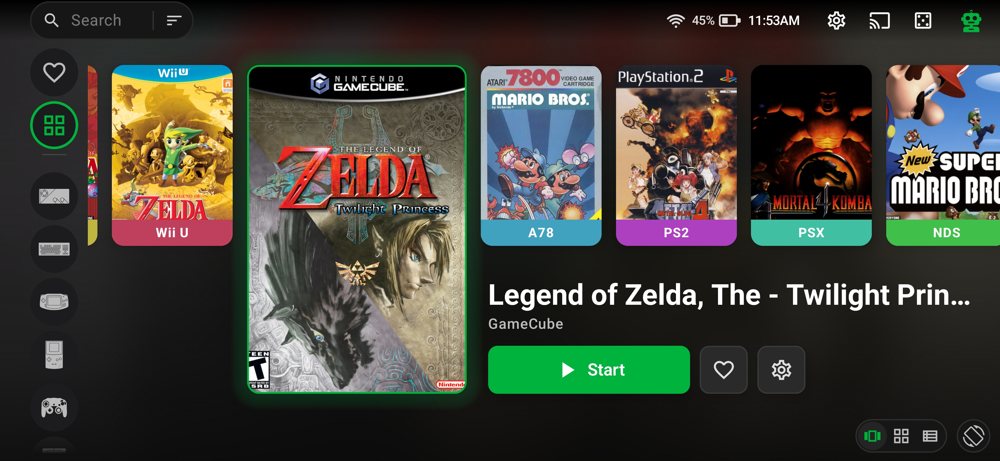
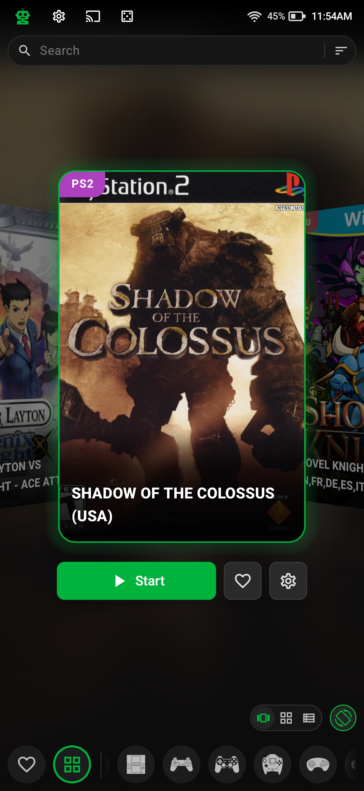
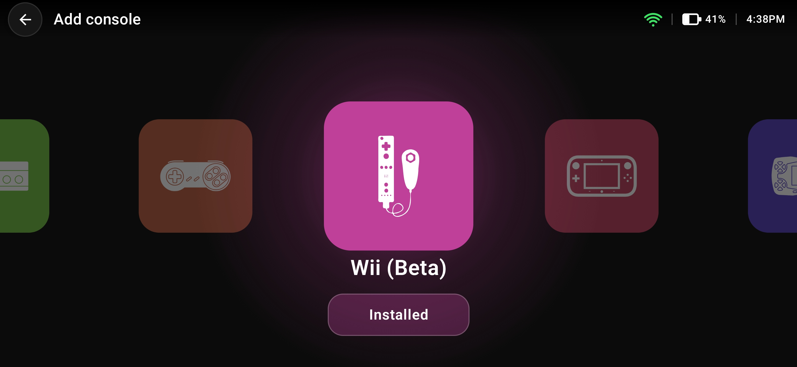
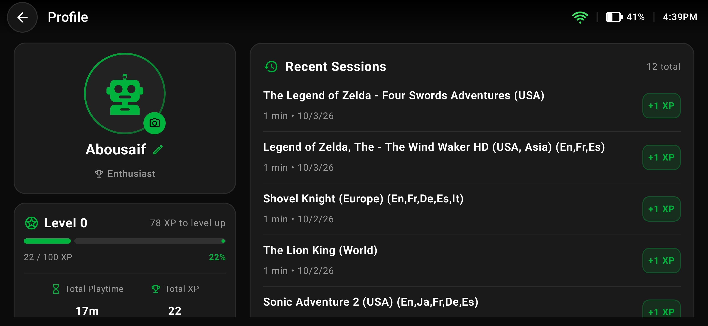

# Omnidroid

<p align="center">
  <a href="https://github.com/Ahmed-Abousaif/Omnidroid/releases"></a>
  <a href="https://github.com/Ahmed-Abousaif/Omnidroid/stargazers"></a>
  <a href="https://github.com/Ahmed-Abousaif/Omnidroid/blob/master/COPYING"></a>
  <a href="https://github.com/Ahmed-Abousaif/omni-libretrodroid"></a>
</p>

<p align="center">
  <strong>Omnidroid</strong> is a modern, landscape-first, Libretro-powered multi-console emulation platform for Android. Forked from <a href="https://github.com/Swordfish90/Lemuroid">Lemuroid</a>, Omnidroid elevates mobile and handheld gaming with native <strong>Vulkan hardware acceleration</strong>, complete <strong>controller-first navigation</strong>, rich <strong>RAWG game metadata & trailers</strong>, multi-provider <strong>cloud saves</strong>, and a built-in <strong>gamer profile & XP progression system</strong> — all packaged into a lightweight release (&lt;8.5 MB APK).
</p>

<p align="center">
  <a href="#-support-omnidroid"><b>Support</b></a> •
  <a href="#-screenshots"><b>Screenshots</b></a> •
  <a href="#-for-players-getting-started"><b>For Players</b></a> •
  <a href="#-supported-consoles--systems"><b>Supported Systems</b></a> •
  <a href="#-features-deep-dive"><b>Features</b></a> •
  <a href="#-for-contributors--developers"><b>For Contributors</b></a> •
  <a href="#star-history"><b>Star History</b></a>
</p>

---

## ☕ Support Omnidroid

If Omnidroid helps you play, you can fuel continued development here:

<p align="center">
  <a href="https://www.buymeacoffee.com/abousaif"></a>
  &nbsp;&nbsp;&nbsp;&nbsp;
  <a href="https://ko-fi.com/abousaif"></a>
</p>

---

## 📸 Screenshots

<p align="center">
  
</p>
<p align="center">
  <em>Landscape console view with cover artwork, full game details, and quick play actions</em>
</p>

<table align="center" width="100%">
  <tr>
    <td width="31.8%" rowspan="2" align="center" valign="middle">
      <br />
      <b>Portrait Console Carousel</b><br />
      <sub>Interactive cover flow carousel, quick Continue & live search</sub>
    </td>
    <td width="68.2%" align="center" valign="middle">
      <br />
      <b>Console Carousel</b><br />
      <sub>On-demand Libretro cores & database slice downloads</sub>
    </td>
  </tr>
  <tr>
    <td width="68.2%" align="center" valign="middle">
      <br />
      <b>Gamer Profile & Stats</b><br />
      <sub>Track play hours, daily streaks, XP leveling & session history</sub>
    </td>
  </tr>
</table>

---

## ⚡ Highlights

- 🌋 **Native Vulkan & OpenGL ES Engine:** Powered by our custom [omni-libretrodroid](https://github.com/Ahmed-Abousaif/omni-libretrodroid) native C++ engine with per-system graphics API switching (Vulkan, GLES 2/3, Software) for rock-solid 60 FPS performance and reduced thermal throttling.
- 🎮 **Controller-First Navigation:** Seamless navigation across the entire app (library, search, consoles, settings, game pages) using physical gamepads with focus glow and button hint bars.
- 📱 **Handheld & Phone UI:** Fluid landscape and portrait modes with dedicated layouts for handhelds (Retroid, Odin, ANBERNIC), phones, tablets, and Android TV.
- 🚀 **Frontend & File Manager Integration:** Exported launcher activity for external frontends (Daijishō, Pegasus, Beacon) and direct "Open With" file manager launching for ROMs and archives without requiring a prior library scan.
- 📚 **Console Carousel & Library Sorting:** Dedicated console views with a portrait cover carousel, landscape details pane, flexible sorting (name, console, recently played, favorites), and random game selection.
- ☁️ **Multi-Cloud Save Sync:** Sync saves seamlessly with **Google Drive**, **Dropbox**, or **OneDrive**, with conflict resolution and offline zip export/import.
- 🎨 **Rich RAWG Game Details:** Automatic cover art, descriptions, genres, release dates, publishers, ratings, and video trailers without scraping YouTube.
- 🏆 **Gamification & Profile System:** Earn XP from play sessions, maintain daily streaks, level up, and unlock collection badges (Collector → Enthusiast → Historian → Omnidroid Master).
- 📺 **Android TV & Big-Screen Integration:** Full Android TV Leanback launcher support with dynamic home screen preview channels for recently played games, plus wireless and HDMI casting.
- 🔋 **Battery-Aware HD Mode:** Intelligently disables heavy HD enhancements when battery drops below 15% to conserve power.
- 🛡️ **Lightweight & 16KB Page-Aligned:** Universal release APK is under 8.5 MB (~27% smaller than baseline) and fully aligned for Android 15+ 16KB memory page sizes.

---

## 🎮 For Players: Getting Started

### 1. Installation

Download the latest APK from the [Releases](https://github.com/Ahmed-Abousaif/Omnidroid/releases) page and install it on your Android device (Android 7.0+ / API 24+ required).

### 2. Adding ROMs

1. Launch Omnidroid and grant storage permissions when prompted.
2. Select the directory where your game ROMs are stored.
3. Omnidroid's **content-based ROM scanner** automatically identifies your games from file headers (no strict folder structure required).
4. Supported compression formats include `.zip`, `.7z`, and `.chd`.

### 3. BIOS Requirements

Most retro consoles run immediately without external BIOS files. For systems that require BIOS dumps:

- **PlayStation 2 (ARMSX2):** Compatible with USA, Europe, and Japan BIOS images.
- Other BIOS files (e.g., PS1, Sega CD, GBA) can be placed in the standard Libretro system folder.

### 4. Controller Setup

- **Physical Gamepads:** Plug in via USB or pair via Bluetooth (Xbox, PlayStation DualShock/DualSense, Nintendo Switch Pro, 8BitDo, and integrated handheld controls). Key mappings are applied automatically.
- **Touch Controls:** On-screen virtual pads can be customized for size, position, opacity, and 4-way vs. 8-way D-Pad modes. Retro systems support routing the virtual analog stick to D-Pad inputs.

### 5. Cloud Saves Setup

Under **Settings → Saves**, log into **Google Drive**, **Dropbox**, or **OneDrive** to enable automatic cloud backup and cross-device sync. You can also export or import a local `.zip` backup of all your saves anytime.

---

## 🕹️ Supported Consoles & Systems

Omnidroid supports a massive range of retro and modern consoles powered by Libretro cores:

| System                             | Console / Generation     | Emulation Core                                                                                                                                                      |
| :--------------------------------- | :----------------------- | :------------------------------------------------------------------------------------------------------------------------------------------------------------------ |
| **Nintendo 3DS**                   | Handheld (8th Gen)       | [Azahar](https://github.com/azahar-emu/azahar) / [Citra](https://docs.libretro.com/library/citra/)                                                                  |
| **Nintendo Wii U** _(Beta)_        | Home Console (8th Gen)   | [Cemu](https://github.com/cemu-project/Cemu)                                                                                                                        |
| **Nintendo Wii** _(Beta)_          | Home Console (7th Gen)   | [Dolphin](https://docs.libretro.com/library/dolphin/)                                                                                                               |
| **Nintendo GameCube**              | Home Console (6th Gen)   | [Dolphin](https://docs.libretro.com/library/dolphin/)                                                                                                               |
| **Nintendo DS (NDS)**              | Handheld (7th Gen)       | [melonDS DS](https://github.com/JesseTG/melonds-ds)                                                                                                                 |
| **Nintendo 64 (N64)**              | Home Console (5th Gen)   | [mupen64plus](https://docs.libretro.com/library/mupen64plus/)                                                                                                       |
| **Game Boy Advance (GBA)**         | Handheld (6th Gen)       | [mgba](https://docs.libretro.com/library/mgba/)                                                                                                                     |
| **Game Boy / Color (GB/GBC)**      | Handheld (4th/5th Gen)   | [gambatte](https://docs.libretro.com/library/gambatte/)                                                                                                             |
| **Super Nintendo (SNES)**          | Home Console (4th Gen)   | [snes9x](https://docs.libretro.com/library/snes9x/)                                                                                                                 |
| **NES / Famicom**                  | Home Console (3rd Gen)   | [fceumm](https://docs.libretro.com/library/fceumm/)                                                                                                                 |
| **PlayStation 2 (PS2)** _(Beta)_   | Home Console (6th Gen)   | [ARMSX2](https://github.com/Ahmed-Abousaif/ARMSX2)                                                                                                                  |
| **PlayStation Portable (PSP)**     | Handheld (7th Gen)       | [ppsspp](https://docs.libretro.com/library/ppsspp/)                                                                                                                 |
| **PlayStation (PSX)**              | Home Console (5th Gen)   | [PCSX-ReARMed](https://docs.libretro.com/library/pcsx_rearmed/)                                                                                                     |
| **Sega Dreamcast**                 | Home Console (6th Gen)   | [flycast](https://docs.libretro.com/library/flycast/)                                                                                                               |
| **Sega Genesis / Mega Drive**      | Home Console (4th Gen)   | [genesis_plus_gx](https://docs.libretro.com/library/genesis_plus_gx/)                                                                                               |
| **Sega CD / Mega CD**              | Add-on (4th Gen)         | [genesis_plus_gx](https://docs.libretro.com/library/genesis_plus_gx/)                                                                                               |
| **Sega Master System / Game Gear** | 8-bit Console & Handheld | [genesis_plus_gx](https://docs.libretro.com/library/genesis_plus_gx/)                                                                                               |
| **Arcade**                         | Classic Coin-Op Arcade   | [FBNeo](https://github.com/libretro/FBNeo/)                                                                                                                         |
| **PC Engine / TurboGrafx-16**      | Home Console (4th Gen)   | [beetle_pce_fast](https://docs.libretro.com/library/beetle_pce_fast/)                                                                                               |
| **Neo Geo Pocket / Color**         | Handheld (5th/6th Gen)   | [mednafen_ngp](https://docs.libretro.com/library/beetle_neopop/)                                                                                                    |
| **WonderSwan / Color**             | Handheld (5th/6th Gen)   | [beetle_cygne](https://docs.libretro.com/library/beetle_cygne/)                                                                                                     |
| **Atari 2600 / 7800 / Lynx**       | Classic Atari Family     | [stella](https://docs.libretro.com/library/stella/) / [prosystem](https://docs.libretro.com/library/prosystem/) / [handy](https://docs.libretro.com/library/handy/) |

---

## 🔍 Features Deep Dive

<details>
<summary><b>🌋 Vulkan Hardware Acceleration & Graphics API Selection</b></summary>
<br>

- **Custom Native Engine:** Built on our custom `omni-libretrodroid` engine, offering native Vulkan hardware acceleration alongside OpenGL ES 2.0/3.0+ and Software rendering.
- **Per-System API Switching:** Configure Graphics API globally or per console (**Auto**, **Vulkan**, **OpenGL**, **Software**) directly from Settings.
- **Low Overhead:** Drastically lowers CPU draw-call bottlenecks on modern mobile GPUs (Adreno, Mali, Immortalis), maintaining a smooth 60 FPS in demanding cores.
</details>

<details>
<summary><b>📱 Handheld-First Launcher & UI Customization</b></summary>
<br>

- **Console Carousel & Details View:** Portrait mode offers an interactive cover flow carousel, while landscape mode features a side-by-side view with cover art, release metadata, and instant play actions.
- **Library Sorting & Random Play:** Sort by title, console, recently played, or favorites, plus a random game button for spontaneous gaming.
- **Dual Layout Engines:** Switch seamlessly between **Grid View** (with dynamic zoom slider based on screen height) and a compact **List View**.
- **Landscape Navigation:** Dedicated sidebar for quick navigation between All Games, Favorites, and specific consoles, showing uncropped covers and titles.
- **Display Cutout Awareness:** In-game controls and library chrome hug closer to screen cutouts and camera notches for maximum screen utilization.
- **Startup Screen Selector:** Choose what Omnidroid opens to on launch (All Games, Favorites, or a favorite console).
- **Home Screen Launcher:** Set Omnidroid as your Android device's default launcher for a dedicated console feel.
- **System Telemetry:** Live on-screen battery percentage, Wi-Fi/mobile network status, and connected gamepads right on the top bar.
</details>

<details>
<summary><b>🚀 External Frontends & File Manager Launching</b></summary>
<br>

- **Frontend Launcher Contract:** Boot games directly from external launchers like Daijishō, Pegasus, and Beacon using `ExternalGameLauncherActivity` with standard Android `ACTION_VIEW` intents.
- **Console Disambiguation:** Accepts the `SYSTEM` extra to automatically route shared formats (.chd, .iso, .zip) to the correct console core.
- **"Open With" File Manager Support:** Tap any supported ROM or zipped archive in your Android file manager to boot directly into the game without requiring a prior library scan.
- **Clean Return on Exit:** Quitting an externally launched game returns focus directly to the calling frontend without leaving stale tasks on your recent apps overview.
</details>

<details>
<summary><b>📺 Android TV Home Screen & Leanback Support</b></summary>
<br>

- **Leanback Launcher:** Native Android TV home screen banner and D-pad optimized navigation designed for a 10-foot couch experience.
- **Home Screen Channels:** Automatically publishes a dynamic "Omnidroid" recommendations row on the Android TV home screen displaying recently played games.
- **Direct Resume:** Click any game tile directly from your TV home screen to resume playing immediately.
</details>

<details>
<summary><b>🕹️ Dual-Screen Layouts (Nintendo 3DS & DS)</b></summary>
<br>

- **Flexible Screen Configurations:** Default Top-Bottom, Side-by-Side (Left-Right), or Single Screen (Top or Bottom).
- **Quick Screen Toggle:** Tap the on-screen layout button to instantly toggle between dual-screen and single top-screen without opening menus.
- **True Stylus Multi-Touch:** Bottom touch screen supports simultaneous multi-touch input, allowing you to use the stylus overlay while holding virtual buttons.
- **Hide Pads Mode:** Tap the pad toggle to slide virtual controls away for stylus-heavy gameplay; tap the edge tab to bring them back.
</details>

<details>
<summary><b>🐬 GameCube & Wii Emulation (Dolphin Core)</b></summary>
<br>

- **Automated Sys Asset Provisioning:** Essential Dolphin `Sys/` assets (game database, system fonts, DSP binary engines) are downloaded automatically on first launch.
- **Adaptive Internal Resolution Scaling:** 1x Native (640×528), 2x (720p), 3x (1080p), and 4x (1440p / QHD) with dynamic intermediate framebuffer reallocation.
- **Versatile Controller Profiles:** Native GameCube controller, Sideways Wiimote (for 2D platformers), Wiimote + Nunchuk (for 3D adventures), and Wii Classic Controller.
- **Ghost Controller Prevention:** Automatically disconnects unused controller ports to prevent false multiplayer detections in games like _Super Smash Bros. Melee_.
</details>

<details>
<summary><b>⚡ PlayStation 2 & Wii U Emulation</b></summary>
<br>

- **PlayStation 2 (ARMSX2):** PCSX2-derived 64-bit ARM core with Vulkan, OpenGL, and Software rendering pipelines. Features dedicated DualShock 2 touch layout with dual analog sticks, rumble support, and automatic BIOS verification.
- **Nintendo Wii U (Cemu):** Vulkan-accelerated 64-bit ARM core with Multi-Core Recompiler support, interactive touch GamePad view, and side-by-side TV/GamePad rendering.
</details>

<details>
<summary><b>🌐 RAWG Metadata & In-App Search</b></summary>
<br>

- Under **Settings → Advanced**, enable **RAWG Game Metadata** and enter a free API key from [rawg.io/apidocs](https://rawg.io/apidocs).
- Automatically fetches game backdrops, descriptions, release dates, ratings, and MP4 game trailers.
- Includes in-app "Fix Match / Search Box Art" dialog with token-fuzzy search and franchise alias resolution.
</details>

<details>
<summary><b>📊 Device Profile & Hardware Benchmarking</b></summary>
<br>

- Under **Settings → Advanced → Device profile**, view detailed hardware specs: SoC, RAM, CPU cores/frequencies, GPU / OpenGL ES, and Vulkan driver versions.
- Built-in 30-second CPU benchmark measures emulation throughput in ops/s.
</details>

---

## 🛠️ For Contributors & Developers

We welcome contributions of all kinds — whether you are optimizing emulation cores, refining Jetpack Compose UI, improving controller support, or improving documentation!

### Architecture & Repository Modules

```text
Omnidroid/
├── omnidroid-app/               # Main application module (Compose UI, ViewModels, Room DB)
├── omnidroid-app-ext-free/      # Free distribution flavor configuration
├── omnidroid-app-ext-play/      # Google Play flavor (Cloud services, Drive/Dropbox/OneDrive)
├── omnidroid-touchinput/        # Virtual touch controller overlay and input routing
├── omnidroid-chd/               # CHD compressed disc image decompression library
├── omnidroid-metadata-rawg/     # RAWG.io API client for descriptions, ratings & trailers
├── omnidroid-metadata-libretro/ # Libretro DB offline game title identification
├── libretrodroid/               # JNI bridge between Android and native Libretro cores
├── omni-libretrodroid/          # (Submodule) Custom native Vulkan/GLES C++ emulation runtime
├── omnidroid-cores/             # (Submodule) Prebuilt Libretro emulation core binaries
├── retrograde-app-shared/       # Shared UI components and emulation lifecycle utilities
└── retrograde-util/             # File system, archive, and platform utility routines
```

### Development Setup

1. **Prerequisites:**
   - **Android Studio:** Ladybug (2024.2+) or Meerkat recommended.
   - **JDK:** Java 17 (e.g. Eclipse Temurin 17 or OpenJDK 17).
   - **Android SDK:** `compileSdk` / `targetSdk` **36**, `minSdk` **24**, Build Tools **36.0.0**.
   - **NDK & CMake:** Installed via Android Studio SDK Manager.

2. **Cloning the Repository:**
   Omnidroid uses Git submodules for native engines and emulation cores. Clone recursively:

   ```bash
   git clone --recurse-submodules https://github.com/Ahmed-Abousaif/Omnidroid.git
   cd Omnidroid
   ```

   If already cloned without `--recurse-submodules`:

   ```bash
   git submodule update --init --recursive
   ```

3. **Building the Project:**

   ```bash
   # Build debug APK (Play flavor)
   ./gradlew assemblePlayDebug

   # Build release APK (Free flavor)
   ./gradlew assembleFreeRelease

   # Run code analysis & checkstyle
   ./gradlew checkstyle
   ```

### Modern Toolchain Baseline

| Component                 | Baseline Version      | Notes                                      |
| :------------------------ | :-------------------- | :----------------------------------------- |
| **Android Gradle Plugin** | `9.0.0`               | Modernized build system                    |
| **Kotlin**                | `2.2.10`              | Full Kotlin 2.x support                    |
| **Jetpack Compose BOM**   | `2026.08.00`          | Modern declarative UI & Material 3         |
| **Annotation Processing** | KSP `2.2.10-2.0.2`    | Clean KSP migration (`kapt` removed)       |
| **Dependency Injection**  | Hilt `2.60.1`         | Modern Dagger/Hilt setup                   |
| **Memory Alignment**      | `16KB Page Alignment` | Android 15+ native runtime ready           |
| **Native Runtime**        | `omni-libretrodroid`  | Vulkan hardware acceleration & `-O3` flags |

For coding conventions, Compose navigation guidelines, and pull request procedures, please read our [Contributing Guidelines](.github/CONTRIBUTING.md).

---

## Star History

<a href="https://www.star-history.com/?repos=ahmed-abousaif%2Fomnidroid&type=date&releases=&legend=bottom-right">
 <picture>
   <source media="(prefers-color-scheme: dark)" srcset="https://api.star-history.com/chart?repos=ahmed-abousaif/omnidroid&type=date&theme=dark&legend=bottom-right" />
   <source media="(prefers-color-scheme: light)" srcset="https://api.star-history.com/chart?repos=ahmed-abousaif/omnidroid&type=date&legend=bottom-right" />
   
 </picture>
</a>

---

## 📜 License & Acknowledgements

- **License:** Omnidroid is licensed under the [GNU General Public License v3.0 (GPLv3)](COPYING).
- **Upstream & Heritage:** Based on [Lemuroid](https://github.com/Swordfish90/Lemuroid) by Filippo Scognamiglio, which originated from [Retrograde](https://github.com/retrograde/retrograde-android).
- **Libretro:** Built on the incredible [Libretro](https://www.libretro.com/) ecosystem and powered by the dedicated authors of all open-source emulation cores.
