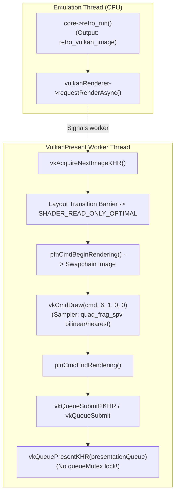
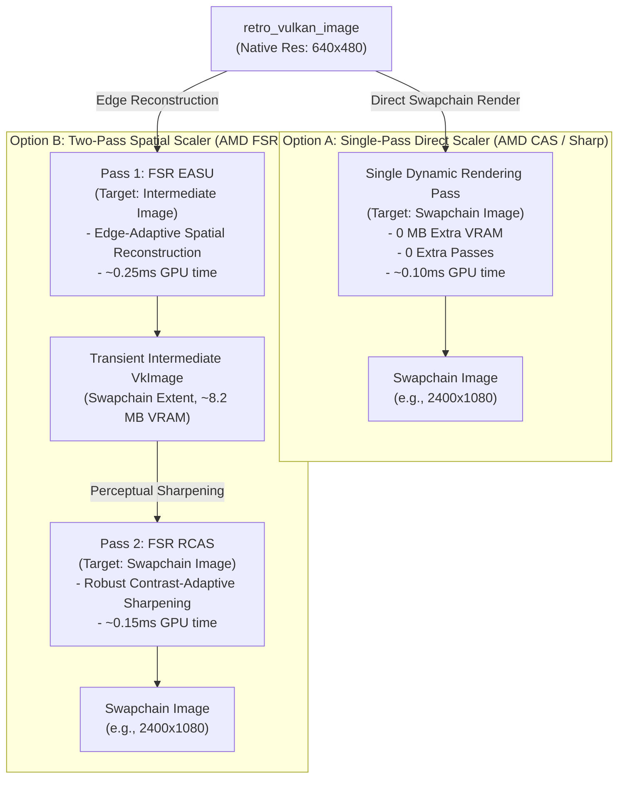

# Omnidroid: Vulkan Upscaling Architecture & Implementation Plan

## Executive Summary

Omnidroid's native Vulkan rendering architecture (`omni-libretrodroid`) features an asynchronous, lock-free, zero-allocation presentation pipeline with dynamic rendering (`VK_KHR_dynamic_rendering`), push descriptors (`VK_KHR_push_descriptor`), and TBDR tile memory optimizations.

While the OpenGL ES 3 pipeline supports multi-pass filters and HD upscaling (Content-Adaptive Upscale Technique / CUT), the Vulkan pipeline currently renders via a simple textured quad using bilinear or nearest sampling (`quad_frag_spv`). This document provides a concrete, production-ready engineering plan to integrate **hardware-accelerated upscaling** directly into the Vulkan rendering pipeline:
1. **AMD FidelityFX Super Resolution 1.0 (FSR 1.0: EASU + RCAS)**: High-quality edge-preserving spatial reconstruction for demanding 3D games (PS2, GameCube, Wii, PSP, 3DS, Wii U).
2. **AMD Contrast-Adaptive Sharpening (CAS)**: Single-pass, zero-bandwidth adaptive sharpening for power efficiency and high frame rate stability.
3. **Omnidroid HD Mode Parity (CUT / Sharp Bilinear)**: Pre-scaled sharp filtering for retro 2D consoles.

---

## 1. Architectural Context & Current Vulkan Pipeline

### 1.1 Where Vulkan Rendering Happens Today


### 1.2 The Bottleneck
- **Native Resolutions**: PS2 (480p), GameCube/Wii (480p), PSP (272p), 3DS (240p).
- When displayed on a 1080p or 1440p phone screen, bilinear interpolation softens edges and blurs fine text/geometry.
- Increasing core internal rendering resolution (e.g. Dolphin 3x, PPSSPP 4x) multiplies internal geometry passes and fill rates, causing aggressive thermal throttling on mobile SoCs.
- **Frontend Spatial Upscaling** allows the core to run at native 1x resolution (maximum speed, minimum battery and thermals), while the frontend reconstructs high-frequency details directly during the final presentation pass in `<0.4ms`.

---

## 2. Upscaler Comparison & Technical Selection



| Mode | Algorithm | Passes | Extra VRAM | Est. GPU Time (Adreno / Mali) | Target Use Case |
|---|---|:---:|:---:|:---:|---|
| **Off (Smooth/Sharp)** | Bilinear / Nearest | 1 | 0 MB | 0.05 ms | Baseline |
| **Sharp Bilinear** | Pre-scaled Integer | 1 | 0 MB | 0.08 ms | 2D Pixel Art (GBA, SNES, PS1) |
| **AMD CAS** | Single-pass Contrast-Adaptive | 1 | 0 MB | 0.10 ms | High performance 3D, battery saving |
| **AMD FSR 1.0** | 2-pass EASU + RCAS | 2 | ~8.2 MB | 0.40 ms | High quality 3D (PS2, GC, Wii, PSP) |

---

## 3. Engineering Implementation Details

### 3.1 Push Constant Structure (`vulkanrenderer.h`)
Expand the std430 push constants structure (64 bytes) to feed source dimensions, destination dimensions, and sharpening factors directly to the fragment shaders without uniform buffer allocations:

```cpp
struct alignas(16) UpscalePushConstants {
    // Vertex transform parameters (0..24 bytes)
    float scaleX;
    float scaleY;
    float offsetX;
    float offsetY;
    float rotation;
    float isFlipped;

    // Fragment upscaling parameters (24..64 bytes)
    float srcWidth;      // Native source width (e.g. 640.0f)
    float srcHeight;     // Native source height (e.g. 480.0f)
    float dstWidth;      // Swapchain target width (e.g. 2400.0f)
    float dstHeight;     // Swapchain target height (e.g. 1080.0f)
    float sharpness;     // 0.0f (soft) to 1.0f (sharp)
    float upscalerType;  // 0 = Off, 1 = SharpBilinear, 2 = CAS, 3 = FSR_EASU, 4 = FSR_RCAS
    float padding[2];
};
```

### 3.2 Shaders in `vulkanshaders.h`
Precompile SPIR-V bytecodes with `RelaxedPrecision` (FP16 arithmetic enabled) to leverage mobile GPU dual-rate FP16 ALUs:
1. `cas_frag_spv`: AMD Contrast-Adaptive Sharpening. Samples a $3 \times 3$ cross kernel, detects local contrast variance, and sharpens without ringing.
2. `fsr_easu_frag_spv`: AMD FSR 1.0 Edge-Adaptive Spatial Upsampling. Performs 12-tap directional filtering to reconstruct diagonal edges.
3. `fsr_rcas_frag_spv`: AMD FSR 1.0 Robust Contrast-Adaptive Sharpening. Restores micro-contrast in linear color space.
4. `sharp_bilinear_frag_spv`: Sharp integer pre-scaling with bilinear interpolation at pixel boundaries.

### 3.3 Intermediate Resource Management in `VulkanRenderer`
For 2-pass upscalers (FSR 1.0):
```cpp
class VulkanRenderer {
    // Intermediate upscale target
    VkImage upscaleImage = VK_NULL_HANDLE;
    VkDeviceMemory upscaleMemory = VK_NULL_HANDLE;
    VkImageView upscaleImageView = VK_NULL_HANDLE;

    // Pipelines
    VkPipeline casPipeline = VK_NULL_HANDLE;
    VkPipeline fsrEasuPipeline = VK_NULL_HANDLE;
    VkPipeline fsrRcasPipeline = VK_NULL_HANDLE;
    VkPipeline sharpBilinearPipeline = VK_NULL_HANDLE;

    int upscaleMode = 0;       // 0=Off, 1=SharpBilinear, 2=CAS, 3=FSR
    float upscaleSharpness = 0.85f;

    void createUpscaleResources();
    void destroyUpscaleResources();
};
```

`createUpscaleResources()` allocates `upscaleImage` with:
- Extent: `swapchainExtent.width x swapchainExtent.height`
- Format: `VK_FORMAT_R8G8B8A8_UNORM`
- Usage: `VK_IMAGE_USAGE_COLOR_ATTACHMENT_BIT | VK_IMAGE_USAGE_SAMPLED_BIT`
- Memory: Device Local (`VK_MEMORY_PROPERTY_DEVICE_LOCAL_BIT`)

### 3.4 Dynamic Rendering Execution in `renderFrame()`

#### Path A: Single-Pass Mode (AMD CAS / Sharp Bilinear)
```cpp
// 1. Transition swapchain image: UNDEFINED -> COLOR_ATTACHMENT_OPTIMAL
// 2. Begin Dynamic Rendering directly on swapchain image:
VkRenderingAttachmentInfoKHR colorAttachment {};
colorAttachment.sType = VK_STRUCTURE_TYPE_RENDERING_ATTACHMENT_INFO_KHR;
colorAttachment.imageView = swapchainImageViews[imageIndex];
colorAttachment.imageLayout = VK_IMAGE_LAYOUT_COLOR_ATTACHMENT_OPTIMAL;
colorAttachment.loadOp = isLetterboxed ? VK_ATTACHMENT_LOAD_OP_CLEAR : VK_ATTACHMENT_LOAD_OP_DONT_CARE;
colorAttachment.storeOp = VK_ATTACHMENT_STORE_OP_STORE;

VkRenderingInfoKHR renderingInfo {};
renderingInfo.sType = VK_STRUCTURE_TYPE_RENDERING_INFO_KHR;
renderingInfo.renderArea.extent = swapchainExtent;
renderingInfo.layerCount = 1;
renderingInfo.colorAttachmentCount = 1;
renderingInfo.pColorAttachments = &colorAttachment;

pfnCmdBeginRendering(cmd, &renderingInfo);

// 3. Bind CAS / Sharp pipeline
vkCmdBindPipeline(cmd, VK_PIPELINE_BIND_POINT_GRAPHICS, casPipeline);

// 4. Push Descriptors: bind currentImage
pfnCmdPushDescriptorSetKHR(cmd, VK_PIPELINE_BIND_POINT_GRAPHICS, pipelineLayout, 0, 1, &write);

// 5. Push Constants & Draw
vkCmdPushConstants(cmd, pipelineLayout, VK_SHADER_STAGE_VERTEX_BIT | VK_SHADER_STAGE_FRAGMENT_BIT, 0, sizeof(UpscalePushConstants), &cachedPush);
vkCmdDraw(cmd, 6, 1, 0, 0);

pfnCmdEndRendering(cmd);

// 6. Transition swapchain image: COLOR_ATTACHMENT_OPTIMAL -> PRESENT_SRC_KHR
```

#### Path B: Two-Pass Mode (AMD FSR 1.0 EASU + RCAS)
```cpp
// --- PASS 1: EASU (Scale source to upscaleImage) ---
// Transition upscaleImage: UNDEFINED -> COLOR_ATTACHMENT_OPTIMAL
// Begin dynamic rendering targeting upscaleImageView
pfnCmdBeginRendering(cmd, &easuRenderingInfo);
vkCmdBindPipeline(cmd, VK_PIPELINE_BIND_POINT_GRAPHICS, fsrEasuPipeline);
pfnCmdPushDescriptorSetKHR(cmd, VK_PIPELINE_BIND_POINT_GRAPHICS, pipelineLayout, 0, 1, &sourceImageWrite);
vkCmdDraw(cmd, 6, 1, 0, 0);
pfnCmdEndRendering(cmd);

// Barrier: upscaleImage COLOR_ATTACHMENT_OPTIMAL -> SHADER_READ_ONLY_OPTIMAL
vkCmdPipelineBarrier(cmd, VK_PIPELINE_STAGE_COLOR_ATTACHMENT_OUTPUT_BIT, VK_PIPELINE_STAGE_FRAGMENT_SHADER_BIT, ...);

// --- PASS 2: RCAS (Sharpen upscaleImage to swapchain) ---
// Transition swapchainImage: UNDEFINED -> COLOR_ATTACHMENT_OPTIMAL
// Begin dynamic rendering targeting swapchainImageViews[imageIndex]
pfnCmdBeginRendering(cmd, &rcasRenderingInfo);
vkCmdBindPipeline(cmd, VK_PIPELINE_BIND_POINT_GRAPHICS, fsrRcasPipeline);
pfnCmdPushDescriptorSetKHR(cmd, VK_PIPELINE_BIND_POINT_GRAPHICS, pipelineLayout, 0, 1, &intermediateImageWrite);
vkCmdDraw(cmd, 6, 1, 0, 0);
pfnCmdEndRendering(cmd);

// Transition swapchain image: COLOR_ATTACHMENT_OPTIMAL -> PRESENT_SRC_KHR
```

---

## 4. JNI, Kotlin & Settings Integration

### 4.1 Native JNI Exports (`libretrodroidjni.cpp`)
```cpp
JNIEXPORT void JNICALL Java_com_omnidroid_libretrodroid_LibretroDroid_setVulkanUpscaler(
    JNIEnv* env, jclass obj, jint mode, jfloat sharpness
) {
    LibretroDroid::getInstance().setVulkanUpscaler(mode, sharpness);
}
```

### 4.2 LibretroDroid Java API (`LibretroDroid.java`)
```java
public static final int VULKAN_UPSCALER_OFF = 0;
public static final int VULKAN_UPSCALER_SHARP = 1;
public static final int VULKAN_UPSCALER_CAS = 2;
public static final int VULKAN_UPSCALER_FSR = 3;

public static native void setVulkanUpscaler(int mode, float sharpness);
```

### 4.3 Data State & View Binding
- Add `var vulkanUpscalerMode: Int = 0` and `var vulkanUpscalerSharpness: Float = 0.85f` to `GLRetroViewData.kt`.
- In `VulkanRetroView.kt`: pass settings to native `LibretroDroid.setVulkanUpscaler(...)`.
- In `ShaderChooser.kt`: When Vulkan is active and HD Mode is enabled, route `HDModeQuality.LOW` $\to$ CAS, `HDModeQuality.HIGH` $\to$ FSR 1.0.

---

## 5. Mobile SoC Thermal & Bandwidth Safeguards

1. **Zero-Overhead Asynchronous Execution**:
   - All upscaling passes execute on the background `"VulkanPresent"` thread. CPU dynarec (EE / PowerPC / MIPS) runs concurrently on the main thread for frame $N+1$.
2. **TBDR Tile Memory Bypass (`DONT_CARE`)**:
   - `loadOp` is dynamically set to `VK_ATTACHMENT_LOAD_OP_DONT_CARE` whenever content fills the screen, preventing ARM Mali and Qualcomm Adreno from clearing tile memory.
3. **Single-Pass CAS Zero-Allocation Path**:
   - For lower-end SoCs (Snapdragon 6-series, MediaTek Helio, Exynos 1xxx), single-pass CAS renders directly into the swapchain buffer with **0 MB allocated memory and 0 intermediate texture writes**.

---

## 6. Implementation Milestones

- [ ] **Milestone 1: Push Constants & Direct Single-Pass CAS**
  - Implement `UpscalePushConstants` in `vulkanrenderer.h`.
  - Embed compiled `cas_frag_spv` in `vulkanshaders.h`.
  - Wire single-pass CAS pipeline in `VulkanRenderer`.
- [ ] **Milestone 2: Intermediate Texture & AMD FSR 1.0 (EASU + RCAS)**
  - Implement transient `upscaleImage` allocation on surface resize.
  - Compile `fsr_easu_frag_spv` and `fsr_rcas_frag_spv`.
  - Wire 2-pass dynamic rendering chain with image barrier.
- [ ] **Milestone 3: JNI & Settings UI**
  - Expose `setVulkanUpscaler` in `LibretroDroid.java` and JNI.
  - Integrate with `ShaderChooser.kt` and Display Settings menu.
- [ ] **Milestone 4: Profiling & Verification**
  - Verify frame times with `LRDStats` GPU timestamp queries.
  - Test across Adreno 7xx/8xx and Mali-G7xx/G9xx chips.

