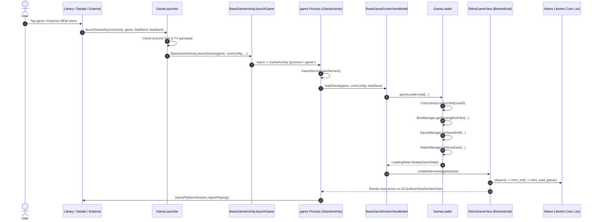
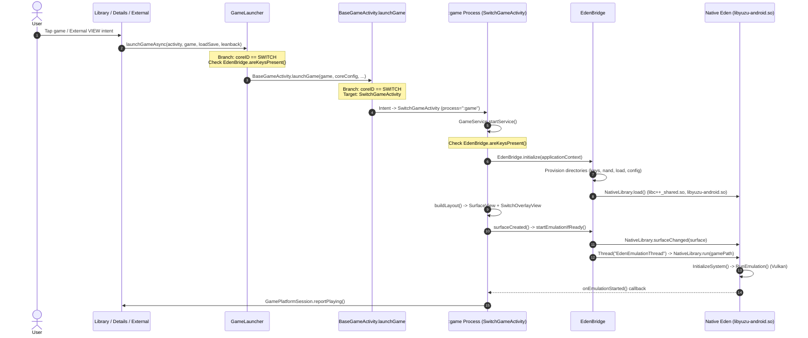
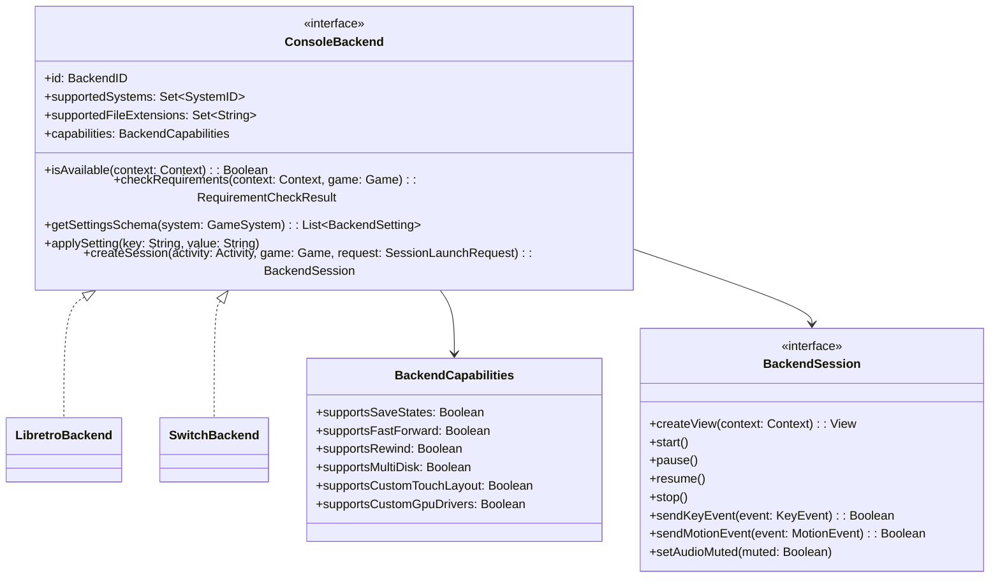

# Phase 1 Investigation Findings: Console Backend Abstraction Layer

**Document:** `docs/console-backends/01-findings.md`  
**Date:** 2026-11-02  
**Status:** Complete — Pending User Review & Approval for Phase 2  
**Author:** Antigravity  

---

## 1. Executive Summary

Omnidroid was originally conceived as a frontend driving libretro emulation cores via `libretrodroid`. Recently, Nintendo Switch emulation was added as an optional module embedding upstream Eden's native C++ library (`libyuzu-android.so`) without libretro.

While the Switch integration is functional, its implementation introduced hardcoded conditionals, parallel code paths, and console-specific screens scattered across the codebase:
1. **Launch Routing**: `BaseGameActivity.launchGame()` branches on `CoreID.SWITCH` to choose between `GameActivity` and `SwitchGameActivity`.
2. **Parallel Activity Implementations**: `SwitchGameActivity` was implemented as a 570-line standalone Activity bypassing `BaseGameActivity` and `BaseGameScreenViewModel`, duplicating lifecycle management, in-game menu dispatch, process termination, playtime tracking, and external launch cleanup.
3. **Requirement Pre-Checks**: Key presence (`EdenBridge.areKeysPresent()`) is checked redundantly in three places (`GameLauncher` twice, `BaseGameActivity` once) plus twice inside `SwitchGameActivity`.
4. **Hardcoded UI Settings & BIOS Screens**: `BiosSettingsScreen` hardcodes a `SwitchKeysCard` alongside `Ps2Choices`. `GameDatabasesScreen` hardcodes a large `when (sliceId)` block. `GraphicsApiSelectionViewModel` hardcodes per-emulator backend settings.
5. **Coupling in Shared Enums**: `CoreID` enum forces non-core emulators to masquerade as libretro cores, requiring a dummy `libretroFileName = "libyuzu-android.so"`.
6. **Feature Capability Flags**: `GameMenuHomeScreen` toggles features using ad-hoc flags (`statesSupported`, `fastForwardSupported`, `numDisks > 1`, `editTouchControlsSupported`) rather than querying a backend capability interface.

Introducing a unified **Console Backend Layer** will decouple the frontend UI, library scanner, launcher, in-game menu, and settings from core-specific mechanics, allowing any emulation backend (libretro, Eden, standalone emulators, or future native integrations) to plug in without touching shared code.

---

## 2. Step-by-Step Launch Pipelines: User Tap to Emulation Running

### 2.1 Libretro Core Pipeline

#### Detailed Step Breakdown:
1. **Trigger**:
   - Internal: User taps game in `GameDetailFragment` or `GameListFragment`, invoking `GameInteractor.launchGame()` -> `GameLauncher.launchGameAsync()`.
   - External: Third-party frontend (Daijishō, ES-DE, Android TV channels) fires `ACTION_VIEW` intent to `ExternalGameLauncherActivity`, which resolves the ROM and invokes `GameLauncher.launchGameAsync(..., isExternalLaunch = true)`.
2. **Pre-flight & Synchronization**:
   - `GameLauncher.launchGameAsync()` verifies that no other game process is running via `GameProcessLock.isHeldByAnotherProcess()`.
   - Resolves `GameSystem.findById(game.systemId)` and `coresSelection.getCoreConfigForSystem(system)`.
   - If cloud save sync is enabled and needed, launches `PreGameSyncActivity`.
   - Otherwise, invokes `BaseGameActivity.launchGame(activity, game, coreConfig, loadSave, leanback, isExternalLaunch)`.
3. **Process Spawn & Activity Navigation**:
   - `BaseGameActivity.launchGame()` constructs an `Intent(activity, GameActivity::class.java)`.
   - Configures extras: `EXTRA_GAME`, `EXTRA_SYSTEM_CORE_CONFIG`, `EXTRA_LOAD_SAVE`, `EXTRA_LEANBACK`, `EXTRA_EXTERNAL_LAUNCH`, and `intent.data = fileUri`.
   - Calls `activity.startActivityForResult(intent, REQUEST_PLAY_GAME)`.
   - Because `GameActivity` specifies `android:process=":game"` in `AndroidManifest.xml`, Android spawns or reuses the isolated worker process `:game`.
4. **Lifecycle & Foreground Service**:
   - `GameActivity` inherits `BaseGameActivity`.
   - In `BaseGameActivity.onCreate()`:
     - Sets `requestedOrientation = ActivityInfo.SCREEN_ORIENTATION_FULL_USER`.
     - Starts `GameService.startService(applicationContext, intent)` to maintain foreground notification and process priority.
     - Instantiates `BaseGameScreenViewModel` via Hilt factory.
     - Calls `setContent { AppTheme { BaseGameScreen(...) { GameScreen(viewModel) } } }`.
     - Calls `baseGameScreenViewModel.loadGame(applicationContext, game, systemCoreConfig, gameLoader, loadSave)`.
5. **Asset & Game Preparation**:
   - `GameLoader.load(...)` emits asynchronous flow states: `LoadingCore` -> `LoadingGame` -> `Ready(GameData)`.
   - Resolves native `.so` library path via `CoreLibraryLocator.find(context, coreID)` (checks bundled native libs, dynamic feature split extraction dirs, or downloaded files).
   - *Console-specific branch*: If `system.id == SystemID.PS2`, triggers `CoreID.getAssetManager(CoreID.ARMSX2).retrieveAssetsIfNeeded()` and `biosManager.stageActivePs2Bios(game)`.
   - Verifies BIOS files with `biosManager.getMissingBiosFiles(systemCoreConfig, game)`. If any required BIOS is missing, throws `GameLoaderException(MissingBiosFiles)`.
   - Resolves physical ROM file or SAF Content URI via `OmnidroidLibrary.getGameFiles(game, dataFiles, useVFS)`.
   - Loads SaveRAM via `savesManager.getSaveRAM(game, systemCoreConfig)`.
   - If `statesSupported` is true, retrieves auto-save via `statesManager.getAutoSave(...)`.
   - Fetches core variables via `coreVariablesManager.getOptionsForCore(system.id, systemCoreConfig)`.
   - Emits `LoadingState.Ready(GameData)`.
6. **View Construction & Native Initialization**:
   - In Compose `MobileGameScreen`: creates `GLRetroGameViewWrapper` (OpenGL ES) or `VulkanRetroView` (Vulkan) via `baseGameScreenViewModel.createRetroView(context, lifecycle)`.
   - Underlying `RetroGameView` (from `libretrodroid`) dynamically loads the core `.so` via JNI.
   - Core receives `retro_set_environment`, `retro_init`, controller configurations, audio/video callbacks, and `retro_load_game()`.
   - `RetroGameView` restores SaveRAM into core memory and restores auto-save state if requested.
   - Emulation thread begins executing `retro_run()` at target frame rate.
   - `GamePlatformSession.reportPlaying(activity)` informs system platform listeners.

---

### 2.2 Switch Pipeline (Eden Native)

#### Detailed Step Breakdown:
1. **Trigger**:
   - Same entry point: User taps Switch game or triggers `ExternalGameLauncherActivity`.
2. **Pre-flight & Keys Checks (Hardcoded Branches)**:
   - In `GameLauncher.launchGameAsync()`:
     - Line 46: `if (system.id == SystemID.SWITCH && !EdenBridge.areKeysPresent(activity)) { showMissingSwitchKeysDialog(activity); return false }`
     - Line 67 (inside coroutine): `if (coreConfig.coreID == CoreID.SWITCH && !EdenBridge.areKeysPresent(activity)) { showMissingSwitchKeysDialog(activity); return@launch }`
3. **Activity Dispatch (Hardcoded Branch)**:
   - In `BaseGameActivity.launchGame()`:
     - Line 578: `if (systemCoreConfig.coreID == CoreID.SWITCH && !EdenBridge.areKeysPresent(activity)) { ... show dialog; return }`
     - Line 594: `val targetClass = if (systemCoreConfig.coreID == CoreID.SWITCH) SwitchGameActivity::class.java else GameActivity::class.java`
     - Starts `Intent(activity, targetClass)` targeting `:game` process.
4. **Lifecycle & Layout Initialization**:
   - `SwitchGameActivity` executes in `:game` process.
   - `onCreate()` checks keys a fourth time: `if (!EdenBridge.areKeysPresent(this)) { showMissingKeysDialogAndFinish(); return }`.
   - Starts `GameService.startService(applicationContext, intent)`.
   - Unpacks Intent extras (`game`, `systemCoreConfig`, `isExternalLaunch`).
   - Calls `EdenBridge.initialize(applicationContext)`:
     - Creates directory tree under `context.filesDir/switch/`: `keys/`, `nand/`, `load/`, `config/`, `cache/`.
     - Calls `NativeLibrary.load()` to load `libc++_shared.so` and `libyuzu-android.so`.
     - Configures GPU driver redirection hooks.
     - Calls `NativeLibrary.setAppDirectory(switchDir)` and `NativeLibrary.reloadKeys()`.
   - Calls `buildLayout()`: Programmatically constructs a `FrameLayout` with:
     - `surfaceView`: Raw `SurfaceView` with `SurfaceHolder.Callback`.
     - `edenOverlay`: `SwitchOverlayView` (custom multi-touch on-screen controller with Omnidroid Menu button).
     - `loadingSpinner`: Indeterminate `ProgressBar`.
5. **Surface Binding & Native Execution**:
   - `surfaceCreated(holder: SurfaceHolder)` triggers `startEmulationIfReady()`.
   - `startEmulationIfReady()`:
     - Calls `EdenBridge.ensureGpuDriver(this)`.
     - Reads SharedPreferences for `switch_docked_mode` and `switch_resolution`.
     - Calls `EdenBridge.startEmulation(gamePath, holder.surface, docked, resSetup, !isAudioEnabled, this)`.
   - `EdenBridge.startEmulation()`:
     - Calls `NativeLibrary.surfaceChanged(surface)` (`ANativeWindow_fromSurface`).
     - Spawns background worker thread `EdenEmulationThread` (`Thread.MAX_PRIORITY`).
     - Calls `NativeLibrary.initializeSystem(false)` and `NativeLibrary.run(gamePath, 0, false)`.
     - Eden's native C++ `EmulationSession` initializes Vulkan swapchain directly on the `ANativeWindow` and starts the emulator execution loop.
   - Eden invokes callback `NativeLibrary.EmulationCallback.onEmulationStarted()`.
   - `SwitchGameActivity` hides the spinner and calls `GamePlatformSession.reportPlaying(this)`.

---

## 3. Comprehensive Inventory of Console- and Backend-Specific Branches

The following table catalogs every console-specific, backend-specific, or core-specific conditional, type check, hardcoded screen, and manifest entry discovered across the Omnidroid codebase:

| Location (File : Line) | Code Construct / Identifier | What It Decides | Concern Category |
| :--- | :--- | :--- | :--- |
| `omnidroid-app/src/main/AndroidManifest.xml:111` | `<activity android:name="...SwitchGameActivity" android:process=":game" />` | Registers separate Activity in manifest for Switch | Launch & Session Lifecycle |
| `omnidroid-app/src/main/AndroidManifest.xml:149` | `<activity android:name="...SwitchKeyPickerLauncher" />` | Invisible trampoline Activity to pick `prod.keys` | Requirements (Keys/BIOS) |
| `omnidroid-app/build.gradle.kts:75` | `dynamicFeatures.add(":omnidroid_core_switch")` | Registers Switch dynamic feature module for Play delivery | Availability & Packaging |
| `settings.gradle.kts:39` | `task.contains("Switch") \|\| task.contains("switch")` | Enables dynamic feature include for Switch Gradle tasks | Availability & Packaging |
| `settings.gradle.kts:68, 95` | `include(":omnidroid_core_switch")` | Projects directory setup for `:omnidroid_core_switch` | Availability & Packaging |
| `omnidroid-app/proguard-rules.pro:88` | `-keep class org.yuzu.yuzu_emu.** { *; }` | ProGuard rule keeping reverse-engineered Eden JNI bridge classes | Availability & Packaging |
| `omnidroid-app/.../game/BaseGameActivity.kt:578` | `if (systemCoreConfig.coreID == CoreID.SWITCH)` | Blocks launch if `prod.keys` missing and shows import dialog | Requirements (Keys/BIOS) |
| `omnidroid-app/.../game/BaseGameActivity.kt:594` | `val targetClass = if (systemCoreConfig.coreID == CoreID.SWITCH) SwitchGameActivity::class.java else GameActivity::class.java` | Routes game launch to dedicated Switch Activity vs standard Libretro Activity | Launch & Session Lifecycle |
| `omnidroid-app/.../game/GameLauncher.kt:46` | `if (system.id == SystemID.SWITCH && !EdenBridge.areKeysPresent(activity))` | Synchronously halts launch and shows missing keys dialog | Requirements (Keys/BIOS) |
| `omnidroid-app/.../game/GameLauncher.kt:67` | `if (coreConfig.coreID == CoreID.SWITCH && !EdenBridge.areKeysPresent(activity))` | Re-checks Switch keys inside coroutine before sync check | Requirements (Keys/BIOS) |
| `omnidroid-app/.../game/SwitchGameActivity.kt:1-570` | Entire class `SwitchGameActivity` | 570-line standalone Activity bypassing `BaseGameActivity`, re-implementing service startup, lifecycle, in-game menu, results, and session stats | Launch & Session Lifecycle |
| `omnidroid-app/.../gamemenu/GameMenuActivity.kt:129, 180` | `extras?.getBoolean(GameMenuContract.EXTRA_EDIT_TOUCH_CONTROLS_SUPPORTED, true)` | Reads capability flag from intent extras | Capabilities & Menu |
| `omnidroid-app/.../gamemenu/GameMenuHomeScreen.kt:195` | `if (gameMenuRequest.editTouchControlsSupported)` | Conditionally hides "Edit Touch Controls" in menu for Switch | Capabilities & Menu |
| `omnidroid-app/.../settings/bios/BiosSettingsScreen.kt:33, 74, 87` | `var switchKeysPresent = EdenBridge.areKeysPresent()`, `SwitchKeysCard(...)` | Hardcodes Nintendo Switch decryption keys UI and file picker in BIOS screen | Requirements (Keys/BIOS) |
| `omnidroid-app/.../settings/bios/BiosSettingsScreen.kt:58, 120` | `val ps2 = uiState.detected.filter { it.systemID == SystemID.PS2 }`, `Ps2Choices(...)` | Hardcodes PS2-specific BIOS selector in generic BIOS screen | Requirements (Keys/BIOS) |
| `omnidroid-app/.../settings/bios/BiosSettingsViewModel.kt:66` | `downloadPs2Bios(fileName)` -> `when (fileName) { Ps2Bios.USA -> ... }` | Hardcodes PS2 asset server region downloads | Requirements (Keys/BIOS) |
| `omnidroid-app/.../settings/slices/GameDatabasesScreen.kt:97-128` | `when (sliceId) { "switch" -> ConsoleInfo(..., "NSW"), ... }` | 30-branch hardcoded switch statement mapping slices to UI titles & badges | Console Metadata |
| `omnidroid-app/.../settings/graphicsapi/GraphicsApiSelectionViewModel.kt:58-65` | `listOf(GraphicsApiSystem(SystemID.NINTENDO_3DS, "citra_graphics_api", ...), ...)` | Hardcoded list of systems and their respective core options for graphics API selection | Settings Schema & UI |
| `omnidroid-app/.../game/ShaderChooser.kt:72, 300` | `when (system.id) { ... SystemID.WII_U, SystemID.SWITCH -> ShaderConfig.Default }` | Hardcoded system IDs in shader selection (even though Switch does not use libretro shaders) | Video & Presentation |
| `omnidroid-app/.../game/viewmodel/TouchScreenLayoutController.kt:22, 34, 189` | `when (coreId) { CoreID.MELONDS_DS -> ..., CoreID.CITRA, CoreID.AZAHAR -> ... }` | Core-specific screen layout toggling and orientation handlers for dual-screen systems | Presentation & Touch Controls |
| `omnidroid-app/.../game/viewmodel/TouchScreenLayoutController.kt:57-97` | `when (coreId) { CoreID.PCSX_REARMED -> ..., CoreID.SNES9X -> ..., CoreID.DOLPHIN -> ..., CoreID.FLYCAST -> ..., CoreID.CEMU -> ... }` | Hardcoded core-specific widescreen hacks and rotation variables | Presentation & Touch Controls |
| `omnidroid-app/.../game/viewmodel/TouchScreenLayoutController.kt:145` | `when (systemId) { ... SystemID.PSP, SystemID.WII_U, SystemID.SWITCH -> 16f / 9f }` | Hardcoded aspect ratio mapping | Console Metadata |
| `omnidroid-app/.../game/viewmodel/GameViewModelTouchControls.kt:265` | `if (systemCoreConfig.coreID == CoreID.MELONDS_DS)` | Branches on MelonDS DS to simulate lid close via L2+Y vs standard THUMBL key | Input Mapping |
| `retrograde-app-shared/.../game/GameLoader.kt:93-97` | `if (system.id == SystemID.PS2) { CoreID.getAssetManager(CoreID.ARMSX2)...; biosManager.stageActivePs2Bios(game) }` | Hardcoded PS2 core assets retrieval and dynamic BIOS symlink/copy staging | Requirements (Keys/BIOS) |
| `retrograde-app-shared/.../bios/BiosManager.kt:99, 140, 150-184` | `if (bios.systemID == SystemID.PS2) ...`, `stageActivePs2Bios()`, `ps2Selection()`, `refreshPs2Library()` | Special handling for PS2 BIOS storage directory (`pcsx2/bios/`) and active selection file | Requirements (Keys/BIOS) |
| `retrograde-app-shared/.../library/CoreID.kt:137-141` | `SWITCH("switch", "Eden", "libyuzu-android.so")` | Non-core emulator forced into libretro CoreID enum with dummy .so filename | Engine Registry |
| `retrograde-app-shared/.../library/CoreID.kt:145-154` | `fun getAssetManager(coreID: CoreID): AssetsManager = when (coreID) { PPSSPP -> ..., ARMSX2 -> ..., DOLPHIN -> ..., CEMU -> ... }` | Hardcoded asset manager factory mapping | Requirements & Assets |
| `retrograde-app-shared/.../library/GameSystem.kt:45` | `when (id) { ... SystemID.PSP, SystemID.WII_U, SystemID.SWITCH -> 16f / 9f }` | Hardcoded aspect ratio mapping in GameSystem model | Console Metadata |
| `retrograde-app-shared/.../library/GameSystem.kt:2352-2451` | Hardcoded `GameSystem(SystemID.SWITCH, ...)` | 100-line static registration in massive `SYSTEMS` list | Console Metadata |
| `retrograde-app-shared/.../library/MetaSystemID.kt:141, 185` | `SWITCH(...)`, `when (systemID) { ... SystemID.SWITCH -> SWITCH }` | Static enum entry and exhaustive when branch | Console Metadata |
| `retrograde-app-shared/.../library/scan/DetectionRules.kt:81-84` | `"xci" to SystemID.SWITCH, "nsp" to ..., "nso" to ..., "nca" to ...` | File extension mapping in ROM scanner | Supported File Types |
| `retrograde-app-shared/.../library/scan/FolderHints.kt:76-78` | `"switch" to SystemID.SWITCH, "nswitch" to ..., "nintendoswitch" to ...` | Folder name hint mapping for scanner disambiguation | Supported File Types |
| `retrograde-app-shared/.../launch/SystemDetector.kt:44, 45` | `"switch" to SystemID.SWITCH, "nswitch" to ...` | String aliases mapping for external launcher intent extras | Supported File Types |
| `retrograde-app-shared/.../core/SliceCatalog.kt:45, 85` | `Slice("switch", ...)` | Database slice catalog entry and name mapping | Console Metadata |
| `retrograde-app-shared/.../saves/migrators/SavesMigrator.kt:16` | `when (this.coreID) { CoreID.MELONDS_DS -> MelonDsDsSavesMigrator; else -> null }` | Hardcoded saves migrator mapping | Save & State Handling |
| `omnidroid-touchinput/.../TouchControllerID.kt:15` | `SWITCH_PRO("switch_pro")` | Touch controller profile identifier | Input Mapping |

---

## 4. Grouping by Concerns & Comparative Analysis

### 4.1 System & Console Metadata

- **What Libretro Does**: Systems are statically enumerated in `SystemID` and `MetaSystemID`. Each system declares metadata (aspect ratio, title, icon, supported extensions) inside the 2,480-line `GameSystem.kt` file. Each system references one or more `SystemCoreConfig` objects pointing to `CoreID`.
- **What Switch Does**: Registered in the exact same static files (`SystemID.SWITCH`, `MetaSystemID.SWITCH`, and 100 lines inside `GameSystem.kt`).
- **Common vs. Implementation-Specific**:
  - *Common*: Console identity (`systemId`, `name`, `titleRes`, `iconRes`, `aspectRatio`, `supportedExtensions`, `uniqueExtensions`).
  - *Implementation-Specific*: The execution backend that actually runs the games. Today, the code assumes every `GameSystem` maps to a `CoreID`.

---

### 4.2 Supported File Types & Content Selection

- **What Libretro Does**:
  - Detection via `DetectionRules.kt` (`cartridge` hashing, `fileNameSystems`, magic numbers in `NintendoDisc`, `iso`, `chd`).
  - Resolves ROM files or SAF URIs via `OmnidroidLibrary.getGameFiles(game, dataFiles, useVFS)`. If `supportsLibretroVFS` is false or the game is compressed, extracts to a temporary cache file.
- **What Switch Does**:
  - Extensions `.xci`, `.nsp`, `.nso`, `.nca` registered in `DetectionRules.kt`, `FolderHints.kt`, and `SystemDetector.kt`.
  - ROM loading: Passes `game.fileUri` directly to `EdenBridge.startEmulation()`. Eden's internal JNI stub `FileUtil.openContentUriFromFilePath()` uses `ContentResolver.openFileDescriptor(uri, "r")` directly, completely avoiding extraction.
- **Common vs. Implementation-Specific**:
  - *Common*: Extension mapping, file identification rules, Content URI permission handling.
  - *Implementation-Specific*: VFS support, whether temporary decompression is required, and how file descriptors/URIs are handed to the native core.

---

### 4.3 Requirements (BIOS, Keys, Firmware, Drivers, Assets)

- **What Libretro Does**:
  - Declares `requiredBIOSFiles` and `regionalBIOSFiles` on `SystemCoreConfig`.
  - Checked prior to boot by `BiosManager.getMissingBiosFiles()`. BIOS files reside in `DirectoriesManager.getSystemDirectory()`.
  - Missing BIOS throws `GameLoaderException(MissingBiosFiles)` and halts launch.
  - Special PS2 case: Assets downloaded via `PCEE2AssetsManager` and regional BIOS staged dynamically in `pcsx2/bios/`.
  - Core Assets: Downloaded via `CoreID.AssetsManager` implementations (`PPSSPPAssetsManager`, `DolphinAssetsManager`, `CemuAssetsManager`).
- **What Switch Does**:
  - Completely bypasses `BiosManager`.
  - Requires `prod.keys` (and optionally firmware/title.keys) in `context.filesDir/switch/keys/`.
  - Pre-flight checks are hardcoded in `GameLauncher` and `BaseGameActivity` using `EdenBridge.areKeysPresent()`.
  - UI import is hardcoded as a distinct card in `BiosSettingsScreen` and launches `SwitchKeyPickerLauncher`.
  - Driver management: `EdenBridge.ensureGpuDriver()` configures custom Turnip/Adreno Vulkan drivers.
- **Common vs. Implementation-Specific**:
  - *Common Concept*: A backend has prerequisite files (BIOS, cryptographic keys, firmware, system assets) with validation rules (checksum, presence, region) and needs a mechanism to report missing requirements and prompt the user to import or download them.
  - *Implementation-Specific*: Where files are placed on disk, specific checksum algorithms, and driver redirection.

---

### 4.4 Availability & Installation of the Module / Engine

- **What Libretro Does**:
  - Packaged either bundled (`:bundled-cores`), on-demand dynamic feature (`:omnidroid_core_*`), or downloaded from GitHub (`GithubCoreDownloader`).
  - Located via `CoreLibraryLocator.find(context, coreID)` looking for `coreID.libretroFileName`.
  - Dynamic features installed via Google Play `SplitInstallManager`.
- **What Switch Does**:
  - Dynamic feature module `:omnidroid_core_switch` containing `libyuzu-android.so`.
  - Also discoverable via `CoreLibraryLocator` because `CoreID.SWITCH` defines `libretroFileName = "libyuzu-android.so"`.
  - Loaded via `EdenBridge.initialize()` -> `NativeLibrary.load()`.
- **Common vs. Implementation-Specific**:
  - *Common*: Engine discovery, install status inquiry (installed vs missing), trigger on-demand download / split-install.
  - *Implementation-Specific*: Dynamic library names, initialization sequence, and native dependencies.

---

### 4.5 Launch & Session Lifecycle

- **What Libretro Does**:
  - Launches `GameActivity` inside `android:process=":game"`.
  - Starts `GameService` foreground service.
  - Driven by `BaseGameScreenViewModel`, which uses `GameLoader` to resolve core, files, SaveRAM, and quick saves.
  - Emits `LoadingState` to update UI until ready.
- **What Switch Does**:
  - Launches `SwitchGameActivity` inside `android:process=":game"`.
  - Starts `GameService` foreground service.
  - Bypasses `BaseGameScreenViewModel` and `GameLoader`.
  - Initializes Eden in `onCreate()`, binds `SurfaceHolder`, starts an `EdenEmulationThread` that calls `NativeLibrary.run()`.
  - Duplicates back-button handling, error handling, dialogs, and exit termination.
- **Common vs. Implementation-Specific**:
  - *Common*:
    - Process isolation model (`:game` process terminated on exit).
    - Foreground service tracking (`GameService`).
    - Input parameters: `game`, `loadSave`, `leanback`, `isExternalLaunch`.
    - Session exit reporting (`RESULT_OK`, `RESULT_ERROR`, duration, XP, cloud save trigger).
  - *Implementation-Specific*:
    - The actual rendering surface and native threading loop (`RetroGameView` loop vs `EdenEmulationThread`).

---

### 4.6 Video & Audio Ownership

- **What Libretro Does**:
  - Video: `GLRetroView` (GLSurfaceView / EGL) or `VulkanRetroView` (SurfaceView with custom C++ render loop in `libretrodroid`). Integrated into Compose hierarchy. Supports Omnidroid's shader pipeline (`ShaderChooser`).
  - Audio: Audio frames pushed to `audio_sample_batch_cb`; `libretrodroid` manages audio output via OpenSL ES or AudioTrack. Muted via `RetroGameView.audioEnabled`.
- **What Switch Does**:
  - Video: Raw Android `SurfaceView` added to a `FrameLayout`. Surface passed directly to Eden's JNI (`NativeLibrary.surfaceChanged`). Eden's internal Vulkan presenter (`vk_present_manager.cpp`) owns swapchain and rendering. Does NOT use Omnidroid shaders.
  - Audio: Eden C++ uses Google Oboe directly. Muted via `EdenBridge.setAudioMuted()`.
- **Common vs. Implementation-Specific**:
  - *Common*: The host provides an Android `Surface` / window container; host can command audio mute/unmute.
  - *Implementation-Specific*: Whether the frontend renders via OpenGL ES / Vulkan bridge or the backend directly drives the `ANativeWindow`.

---

### 4.7 Input Mapping & Touch Controls

- **What Libretro Does**:
  - Gamepad: `BaseGameActivity` forwards key/motion events to `GameViewModelInput`, which translates them into Retropad button IDs using `ControllerConfig`.
  - Touch: Compose overlay in `MobileGameScreen` with configurable radial controls, tilt simulation, and "Edit Touch Controls" editor.
  - Screen toggles: `TouchScreenLayoutController` toggles dual-screen layouts for DS / 3DS.
- **What Switch Does**:
  - Gamepad: `SwitchGameActivity` intercepts key/motion events directly in activity callbacks and calls `EdenBridge.sendOverlayButton()` / `sendOverlayJoystick()`.
  - Touch: `SwitchOverlayView` renders a custom touch overlay directly over the SurfaceView. Does not support Omnidroid's radial touch editor.
- **Common vs. Implementation-Specific**:
  - *Common*: Routing physical gamepads/keyboards and receiving touch overlay interactions.
  - *Implementation-Specific*: The button enumeration (Retropad vs Switch NativeButton/Analog) and overlay presentation.

---

### 4.8 Save & State Handling

- **What Libretro Does**:
  - SaveRAM (`.srm`/`.sav`) managed by `SavesManager`. Loaded into memory before boot, extracted on pause/exit, and written to disk.
  - Savestates (`.state`) managed by `StatesManager` with slot support and preview screenshots (`StatesPreviewManager`).
  - Saves migration via `SystemCoreConfig.getSavesMigrator()`.
- **What Switch Does**:
  - Saves handled completely internally by Eden's virtual NAND filesystem (`context.filesDir/switch/nand/user/save/...`).
  - Savestates: Not supported by Eden.
- **Common vs. Implementation-Specific**:
  - *Common*: Triggering auto-save on exit, notifying cloud save sync when a session concludes.
  - *Implementation-Specific*: Direct SaveRAM buffer injection vs emulated filesystem NAND persistence.

---

### 4.9 Settings Schema & Configuration UI

- **What Libretro Does**:
  - Static settings: `SystemCoreConfig.exposedSettings`.
  - Dynamic settings: queried live from the core via `retroGameView.getVariables()`.
  - Settings UI rendered dynamically by `GameMenuHomeScreen` -> `CoreOptionsScreen`.
  - Saved to `SharedPreferences` via `CoreVariablesManager.computeSharedPreferenceKey(key, systemId.dbname)`.
- **What Switch Does**:
  - Declares 4 settings in `GameSystem.kt` (`switch_touch_overlay`, `switch_overlay_opacity`, `switch_docked_mode`, `switch_resolution`).
  - Passes them into `GameMenuActivity` using `SystemCoreConfig.exposedSettings`.
  - Manually reads them from `SharedPreferences` in `SwitchGameActivity.applyLiveSettings()` and pushes them via JNI setters (`setDockedMode`, `setResolutionSetup`, etc.).
- **Common vs. Implementation-Specific**:
  - *Common*: Declarative settings schema (`key`, `title`, `options`, `defaultValue`), storage in `SharedPreferences`, presentation in `GameMenuActivity`.
  - *Implementation-Specific*: How live changes are delivered to the emulation engine (libretro variable callback vs direct JNI config setters).

---

### 4.10 Capabilities

- **What Libretro Does**:
  - Supports savestates (`statesSupported = true` on most cores).
  - Fast-forward (`fastForwardSupport = true`, speed multiplier up to 8x).
  - Multi-disk switching (`hasMultiDiskSupport = true`, `getCurrentDisk`, `changeDisk`).
  - Rewind support.
  - Radial touch controls editing.
- **What Switch Does**:
  - Savestates: NO (`statesSupported = false`).
  - Fast-forward: NO (`fastForwardSupport = false`).
  - Multi-disk: NO (`hasMultiDiskSupport = false`).
  - Touch control editor: NO (`editTouchControlsSupported = false`).
- **Common vs. Implementation-Specific**:
  - *Common*: Capability flags describing what features a backend supports.
  - *Current Problem*: Flags were added ad-hoc across `SystemCoreConfig`, `GameSystem`, and `GameMenuContract` extras instead of a unified backend capability query.

---

### 4.11 Exit, Return, & Stats Recording

- **What Libretro Does**:
  - `BaseGameActivity` saves state and invokes `finishAndExitProcess()`.
  - Computes session duration, updates streak and XP via `UserProfileStore` and `XPCalculator`, updates database `lastPlayedAt`, inserts `GameSession`, enqueues `SaveSyncWork`.
  - Calls `GameService.requestTermination()` to shut down the foreground service and kill `:game` process.
- **What Switch Does**:
  - `SwitchGameActivity` executes identical logic line-for-line in `finishAndExitProcess()` and `performExternalGameFinishCleanup()`.
- **Common vs. Implementation-Specific**:
  - *Common*: 100% common! The termination sequence, result extras, playtime calculation, XP calculation, and process termination are identical.

---

## 5. Other Non-Core Consoles and External Launches in the Codebase

1. **Wii U / Cemu**:
   - Submoduled at `modules/cemu/upstream/cemu-libretro-android`.
   - Packaged as dynamic feature `:omnidroid_core_cemu`.
   - **Crucially, Cemu is a Libretro Core**: It produces `libcemu_libretro_android.so` and adheres to the libretro API. It is NOT an independent native backend.
2. **Dolphin, Flycast, ARMSX2 (PCSX2), PPSSPP, Citra/Azahar, MelonDS DS**:
   - All are libretro cores producing `.so` files driving `RetroGameView`.
   - Some have specialized asset managers (`PCEE2AssetsManager`, `PPSSPPAssetsManager`, etc.) or layout controllers (`TouchScreenLayoutController`), but their execution lifecycle is entirely libretro.
3. **External Launch Ingress vs Egress**:
   - **Ingress (External Frontends -> Omnidroid)**: `ExternalGameLauncherActivity` is an entry point allowing Daijishō, ES-DE, etc. to launch games inside Omnidroid.
   - **Egress (Omnidroid -> External Standalone Emulators)**: Currently **none exist** in the codebase. All emulation is hosted in-process inside the `:game` process.

---

## 6. Synthesis: The Seams Needed for Phase 2

To eliminate every per-console branch found in Phase 1 without regressing functionality, the Console Backend Layer should address:

### Key Seams to Introduce:
1. **`ConsoleBackend` Contract**:
   - **Availability**: Is the backend installed and supported on the device CPU architecture?
   - **Requirements**: Are keys/BIOS/firmware present? Returns `RequirementCheckResult` (Ready vs Missing with import/download action).
   - **Capabilities**: Declarative flags (`supportsSaveStates`, `supportsFastForward`, `supportsMultiDisk`, `supportsCustomTouchLayout`).
   - **Settings Schema**: Declarative settings descriptor allowing generic rendering in `GameMenuHomeScreen` and settings screens.
   - **Session Factory**: Creates a `BackendSession` that binds to the host Activity.
2. **`BackendSession` Contract**:
   - Encapsulates view creation (`SurfaceView` or `RetroGameView`), input forwarding, mute control, pause, resume, and stop.
   - Allows `BaseGameActivity` to be the **single host Activity** for all games in the `:game` process, deleting `SwitchGameActivity` and all duplicate lifecycle/stats code.
3. **Backend Registry (`ConsoleBackendRegistry`)**:
   - Discovers and resolves backends by `SystemID`, `CoreID`, or file extension.
4. **Declarative Requirements & Settings**:
   - `BiosSettingsScreen` renders backend requirements dynamically instead of hardcoded `SwitchKeysCard` and `Ps2Choices`.
   - `GameLauncher` checks requirements via the backend contract rather than `if (coreConfig.coreID == CoreID.SWITCH)`.

---

## 7. Ambiguities & Questions for the User (Phase 1 Sign-Off)

Before proceeding to **Phase 2 (Design)**, here are four questions to confirm:

1. **Single Host Activity vs Pluggable Activities**:
   - *Option A (Recommended)*: `BaseGameActivity` acts as the single universal game Activity in `:game` process. The backend session provides a `View` (either `RetroGameView` or `SurfaceView`), eliminating `SwitchGameActivity` and 500+ lines of duplicated code.
   - *Option B*: Keep separate Activities (`GameActivity`, `SwitchGameActivity`) registered in manifest, but have `ConsoleBackend` declare its target Activity class.
   - *Which approach do you prefer?*
2. **Dual Overlay Support for Switch**:
   - `SwitchGameActivity` currently only displays `SwitchOverlayView` (Eden touch overlay). Omnidroid's radial controller (`TouchControllerID.SWITCH_PRO`) is registered in shared code but not yet wired to Eden input events. Should the backend abstraction enable switching between Eden's touch overlay and Omnidroid's radial controller via a capability/option?
3. **External Standalone Emulators (Egress)**:
   - Does "other non-core consoles later (e.g. other standalone emulators embedded as native libs or launched externally)" mean the backend interface should anticipate launching third-party Android apps via Intents (e.g., launching official standalone PPSSPP / Citra APKs with SAF file URIs and waiting for results)?
4. **Stored Identifier Migrations**:
   - Currently, `Game.systemId` stores `"switch"`, and `SystemCoreConfig.coreID` stores `CoreID.SWITCH` (`"switch"`). Do you want to preserve `CoreID.SWITCH` for backwards compatibility in existing databases, or migrate to a new identifier namespace?

---
*End of Phase 1 Findings.*

