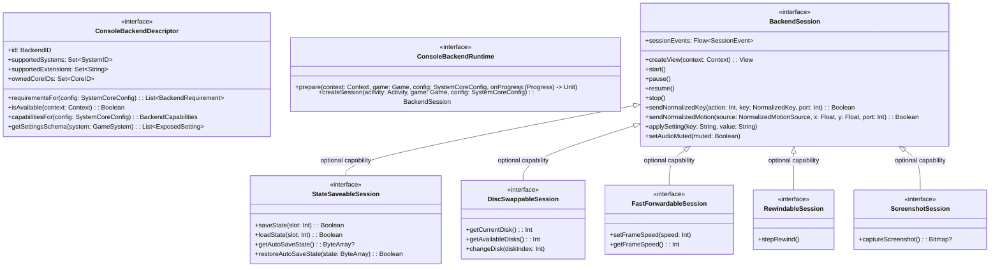
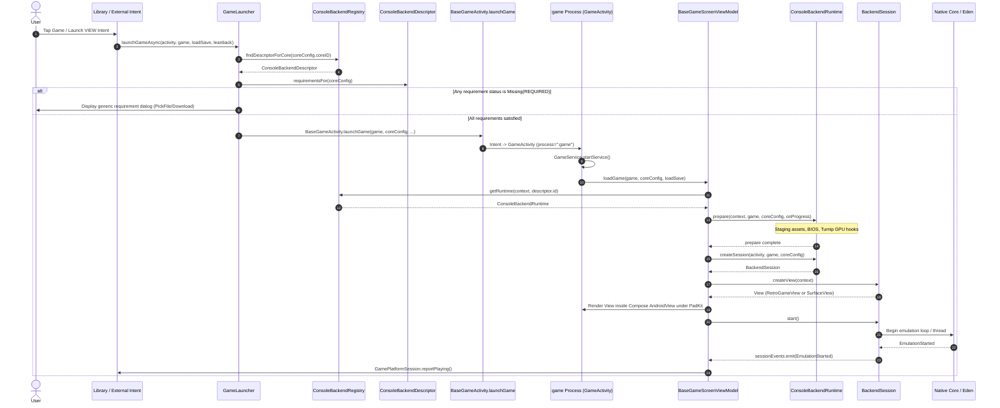

# Phase 2 Design: Unified Console Backend Layer

**Document:** `docs/console-backends/02-design.md`  
**Date:** 2026-11-02 (Revised & Implemented)  
**Status:** Approved & Implemented (Phase 3 Complete)  
**Author:** Antigravity

---

## 1. Executive Summary & Recapped Goals

Omnidroid's game execution architecture currently treats libretro cores as the implicit default execution path, while Nintendo Switch (via upstream Eden's C++ library, `libyuzu-android.so`) was bolted on via special cases, a duplicate standalone `SwitchGameActivity`, hardcoded key checks, and per-console UI screens.

The goal of this design is to introduce a **single, unified console backend abstraction** that every built-in way of running a game implements.

### Core Architectural Invariants:

1. **Single Universal Host Activity**: `BaseGameActivity` executes in `android:process=":game"` as the single host for all emulators. A backend session provides its rendering `View` (`RetroGameView` for libretro, `SurfaceView` for Eden), eliminating `SwitchGameActivity` and all duplicated lifecycle, service, stats, and exit code.
2. **Built-in Omnidroid Controls Only**: Switch uses only Omnidroid's standard input pipeline (`TouchControllerID.SWITCH_PRO` and physical gamepads). `SwitchOverlayView` is completely removed. Sessions receive normalized input events from the host.
3. **Dynamic-Feature Boundary & Descriptor vs. Runtime Separation**:
   - `EdenBridge.kt` and `areKeysPresent()` currently live in the base application module (`omnidroid-app/src/main/java/com/omnidroid/app/shared/switch_emu/EdenBridge.kt:48-55`), while the dynamic feature module `:omnidroid_core_switch` packages strictly the native binary `libyuzu-android.so` (`omnidroid-cores/omnidroid_core_switch/src/main/jniLibs/arm64-v8a/libyuzu-android.so`).
   - We verified by inspection of `EdenBridge.kt:48-55` that `areKeysPresent(context)` performs pure filesystem queries (`File(context.filesDir, "switch/keys/prod.keys").exists()`) and **does NOT trigger native library loading**.
   - Descriptors (systems, extensions, requirement metadata, capabilities, settings schemas) are lightweight, pure-Kotlin data structures compiled into base-app modules, usable without loading native `.so` files or downloading dynamic feature splits.
   - Heavy runtimes and native sessions load from the feature module strictly after installation. Because dynamic-feature code cannot be resolved at compile-time by the base app and Hilt cannot generate cross-split aggregated components without reflection entry points, runtime factories are loaded via reflection (`Class.forName` after `SplitCompat.install()`).
4. **All Emulation Stays In-Process**: Emulation remains strictly inside Omnidroid's `:game` process. No third-party standalone emulator APKs will be launched externally.
5. **Zero Behavior Change & Zero DB Migration**: Existing user libraries, saves, settings, shortcuts, and installed modules remain 100% intact. Stored identifiers (`"switch"`) are preserved. Upstream Eden submodule, patch series, and update scripts remain untouched.

---

## 2. Core Architecture & Interface Contracts



### 2.1 Backend Identifier

```kotlin
@JvmInline
value class BackendID(val value: String) {
    companion object {
        val LIBRETRO = BackendID("libretro")
        val SWITCH = BackendID("switch")
    }
}
```

### 2.2 Capabilities Contract (Per-Configuration)

Capabilities vary by console, core, and configuration (e.g. Snes9x supports savestates; MAME or Eden do not). Capabilities are queried dynamically per `SystemCoreConfig`:

```kotlin
data class BackendCapabilities(
    val supportsSaveStates: Boolean = false,
    val supportsFastForward: Boolean = false,
    val supportsRewind: Boolean = false,
    val supportsMultiDisk: Boolean = false,
    val supportsCustomTouchLayout: Boolean = true,
    val supportsShaders: Boolean = false,
)
```

### 2.3 Requirements & Declarative Actions

Requirements are evaluated per configuration (`requirementsFor(config)`). Each requirement declares its severity (`REQUIRED` vs `RECOMMENDED`):

```kotlin
enum class RequirementSeverity {
    REQUIRED,    // Blocking: game cannot boot without it (e.g. prod.keys for Switch, mandatory BIOS)
    RECOMMENDED, // Non-blocking: warning badge in settings; engine boots via fallback/HLE
}

sealed interface RequirementStatus {
    object Installed : RequirementStatus
    data class Missing(val reasonResId: Int) : RequirementStatus
}

sealed interface RequirementAction {
    data class PickFile(
        val mimeTypes: Array<String>,
        val validator: (InputStream) -> Boolean,
        val destinationFileName: String,
        val destinationDir: (Context) -> File,
    ) : RequirementAction

    data class Download(
        val downloadUrl: String,
        val destinationFile: (Context) -> File,
    ) : RequirementAction

    data class OpenIntent(val intent: Intent) : RequirementAction
}

data class BackendRequirement(
    val id: String,
    val title: String,
    val description: String,
    val severity: RequirementSeverity,
    val checkStatus: (Context) -> RequirementStatus,
    val action: RequirementAction,
)
```

#### How Existing Libretro BIOS Entries Render Generically Without Regression

In `retrograde-app-shared/.../bios/BiosManager.kt:18-20`, `SUPPORTED_BIOS` maintains the database of known BIOS files.
In `LibretroBackendDescriptor.requirementsFor(config)`:

- If `config.requiredBIOSFiles` or `config.regionalBIOSFiles` are present, each entry maps to a `BackendRequirement`:
  - `title`: `bios.displayName()` (`retrograde-app-shared/.../bios/Bios.kt:13`)
  - `description`: `bios.description` (`retrograde-app-shared/.../bios/Bios.kt:8`)
  - `severity`: `REQUIRED` if in `config.requiredBIOSFiles`, else `RECOMMENDED`
  - `checkStatus`: checks `File(systemDir, bios.libretroFileName).exists()`
  - `action`: `RequirementAction.PickFile` targeting `DirectoriesManager.getSystemDirectory()`
- For Switch: `SwitchBackendDescriptor.requirementsFor(config)` returns a single `REQUIRED` requirement for `prod.keys` with destination `context.filesDir/switch/keys/prod.keys`.
- In `BiosSettingsScreen`: A generic `RequirementSection(descriptor)` lists each requirement with status badges (`Installed`, `Missing - Required`, `Missing - Recommended`) and binds file picking directly, replacing the hardcoded `SwitchKeysCard` (`omnidroid-app/.../BiosSettingsScreen.kt:74`) while preserving PS2 choices via the allowlist.

### 2.4 Descriptor Contract (Base-App Safe)

```kotlin
interface ConsoleBackendDescriptor {
    val id: BackendID
    val supportedSystems: Set<SystemID>
    val supportedExtensions: Set<String>
    val ownedCoreIDs: Set<CoreID>

    fun isAvailable(context: Context): Boolean
    fun capabilitiesFor(systemCoreConfig: SystemCoreConfig): BackendCapabilities
    fun requirementsFor(systemCoreConfig: SystemCoreConfig): List<BackendRequirement>
    fun getSettingsSchema(system: GameSystem): List<ExposedSetting>
}
```

### 2.5 Modular Session Interface & Capability Interfaces

Rather than a monolithic interface that forces non-libretro engines to implement or throw on savestate/disk-swap methods, the session contract consists of a **minimal core interface** plus **optional capability interfaces**:

```kotlin
sealed interface SessionEvent {
    object EmulationStarted : SessionEvent
    data class EmulationError(val message: String, val cause: Throwable? = null) : SessionEvent
    data class EmulationExited(val resultCode: Int) : SessionEvent
}

interface BackendSession {
    fun createView(context: Context): View
    fun start()
    fun pause()
    fun resume()
    fun stop()

    fun sendNormalizedKey(action: Int, key: NormalizedKey, port: Int = 0): Boolean
    fun sendNormalizedMotion(source: NormalizedMotionSource, x: Float, y: Float, port: Int = 0): Boolean

    fun applySetting(key: String, value: String)
    fun setAudioMuted(muted: Boolean)

    val sessionEvents: Flow<SessionEvent>
}

// --- Optional Capability Interfaces ---

interface StateSaveableSession : BackendSession {
    suspend fun saveState(slot: Int): Boolean
    suspend fun loadState(slot: Int): Boolean
    suspend fun getAutoSaveState(): ByteArray?
    suspend fun restoreAutoSaveState(state: ByteArray): Boolean
}

interface DiscSwappableSession : BackendSession {
    fun getCurrentDisk(): Int
    fun getAvailableDisks(): Int
    fun changeDisk(diskIndex: Int)
}

interface FastForwardableSession : BackendSession {
    fun setFrameSpeed(speed: Int)
    fun getFrameSpeed(): Int
}

interface RewindableSession : BackendSession {
    fun stepRewind()
}

interface ScreenshotSession : BackendSession {
    suspend fun captureScreenshot(): Bitmap?
}
```

- **Consumer Decoupling**: In `GameMenuHomeScreen`, UI options are enabled via capability checks (`session is StateSaveableSession`, `session as? DiscSwappableSession`), **never type checks** (`is LibretroSession`).
- Switch session implements only `BackendSession`. Libretro session implements `BackendSession`, `StateSaveableSession`, `DiscSwappableSession`, `FastForwardableSession`.

### 2.6 Dynamic-Feature Runtime Registration

To respect the dynamic feature module boundary where the base app cannot have a compile-time dependency on dynamic feature code:

1. Descriptors live in `:retrograde-app-shared` (or `:omnidroid-app`) and register statically.
2. Runtimes are loaded dynamically via reflection after `SplitCompat.install(context)`:

```kotlin
interface ConsoleBackendRuntime {
    suspend fun prepare(
        context: Context,
        game: Game,
        systemCoreConfig: SystemCoreConfig,
        onProgress: (Float, String) -> Unit,
    )

    fun createSession(
        activity: Activity,
        game: Game,
        systemCoreConfig: SystemCoreConfig,
    ): BackendSession
}

object ConsoleBackendRegistry {
    private val descriptors = mutableMapOf<BackendID, ConsoleBackendDescriptor>()
    private val coreIdToBackendId = mutableMapOf<CoreID, BackendID>()
    private val runtimeFactories = mutableMapOf<BackendID, (Context) -> ConsoleBackendRuntime>()

    fun registerDescriptor(descriptor: ConsoleBackendDescriptor) {
        descriptors[descriptor.id] = descriptor
        descriptor.ownedCoreIDs.forEach { coreID ->
            coreIdToBackendId[coreID] = descriptor.id
        }
    }

    fun registerRuntimeFactory(backendId: BackendID, factory: (Context) -> ConsoleBackendRuntime) {
        runtimeFactories[backendId] = factory
    }

    fun getDescriptor(backendId: BackendID): ConsoleBackendDescriptor? = descriptors[backendId]

    fun findDescriptorForCore(coreID: CoreID): ConsoleBackendDescriptor {
        val backendId = coreIdToBackendId[coreID]
            ?: throw IllegalArgumentException("No backend registered for core ID: $coreID")
        return descriptors.getValue(backendId)
    }

    fun getRuntime(context: Context, backendId: BackendID): ConsoleBackendRuntime {
        val factory = runtimeFactories[backendId]
            ?: throw IllegalStateException("Runtime factory not registered for backend: $backendId")
        return factory(context)
    }

    fun allDescriptors(): Collection<ConsoleBackendDescriptor> = descriptors.values
}
```

#### SplitCompat Dynamic Loader

For engines packaged inside dynamic features (like Switch or future engines):

```kotlin
fun loadDynamicRuntime(context: Context, className: String): ConsoleBackendRuntime {
    SplitCompat.install(context)
    val clazz = Class.forName(className)
    return clazz.getDeclaredConstructor().newInstance() as ConsoleBackendRuntime
}
```

In `OmnidroidApplication`:

```kotlin
// Descriptors registered in base app without loading native libraries
ConsoleBackendRegistry.registerDescriptor(LibretroBackendDescriptor())
ConsoleBackendRegistry.registerDescriptor(SwitchBackendDescriptor())

// Runtimes registered: Libretro directly, Switch via dynamic feature loader
ConsoleBackendRegistry.registerRuntimeFactory(BackendID.LIBRETRO) { LibretroBackendRuntime() }
ConsoleBackendRegistry.registerRuntimeFactory(BackendID.SWITCH) { ctx ->
    loadDynamicRuntime(ctx, "com.omnidroid.app.backend.switch_emu.SwitchBackendRuntime")
}
```

_Zero branching on `CoreID.SWITCH` inside the registry lookup._

---

## 3. Unified Game Launch Pipeline

The sequence diagram below maps the single, shared launch flow for both libretro and Switch from user tap to active emulation:



---

## 4. Comprehensive Traceability Table (Reconciled with Allowlist)

Every item from Phase 1 plus additions is reconciled below:

| #   | Location (File : Line)                       | Construct / Identifier                                                         | Status                      | Detailed Rationale                                                                        |
| :-- | :------------------------------------------- | :----------------------------------------------------------------------------- | :-------------------------- | :---------------------------------------------------------------------------------------- |
| 1   | `AndroidManifest.xml:111`                    | `<activity android:name="...SwitchGameActivity" android:process=":game" />`    | **REMOVED**                 | `BaseGameActivity` is the single host in `:game`. Manifest entry deleted in Stage (e).    |
| 2   | `AndroidManifest.xml:149`                    | `<activity android:name="...SwitchKeyPickerLauncher" />`                       | **REMOVED**                 | Replaced by generic file picker driven by `RequirementAction.PickFile`. Activity deleted. |
| 3   | `omnidroid-app/build.gradle.kts:75`          | `dynamicFeatures.add(":omnidroid_core_switch")`                                | **ALLOWLISTED**             | Gradle dynamic feature split configuration. Retained in allowlist.                        |
| 4   | `settings.gradle.kts:39`                     | `task.contains("Switch") \|\| task.contains("switch")`                         | **ALLOWLISTED**             | Root Gradle conditional for dynamic feature build tasks. Retained in allowlist.           |
| 5   | `settings.gradle.kts:68, 95`                 | `include(":omnidroid_core_switch")`                                            | **ALLOWLISTED**             | Gradle subproject include path. Retained in allowlist.                                    |
| 6   | `omnidroid-app/proguard-rules.pro:88`        | `-keep class org.yuzu.yuzu_emu.** { *; }`                                      | **ALLOWLISTED**             | Keep rules for Eden C++ JNI bridge class lookups. Retained in allowlist.                  |
| 7   | `BaseGameActivity.kt:578`                    | `if (systemCoreConfig.coreID == CoreID.SWITCH)`                                | **REMOVED**                 | Requirements checked generically via `descriptor.requirementsFor(config)`.                |
| 8   | `BaseGameActivity.kt:594`                    | `val targetClass = if (coreID == SWITCH) SwitchGameActivity else GameActivity` | **REMOVED**                 | Launch always targets `GameActivity` (`BaseGameActivity`).                                |
| 9   | `GameLauncher.kt:46`                         | `if (system.id == SWITCH && !EdenBridge.areKeysPresent())`                     | **REMOVED**                 | Replaced by generic pre-flight check on `ConsoleBackendDescriptor`.                       |
| 10  | `GameLauncher.kt:67`                         | `if (coreConfig.coreID == SWITCH && !EdenBridge.areKeysPresent())`             | **REMOVED**                 | Redundant second check deleted entirely.                                                  |
| 11  | `SwitchGameActivity.kt:1-570`                | Standalone Activity implementation                                             | **REMOVED**                 | Replaced by `SwitchBackendSession` inside `BaseGameActivity`. Deleted in Stage (e).       |
| 12  | `GameMenuActivity.kt:129, 180`               | `EXTRA_EDIT_TOUCH_CONTROLS_SUPPORTED`                                          | **REMOVED**                 | Replaced by `capabilitiesFor(config).supportsCustomTouchLayout`. Intent extra removed.    |
| 13  | `GameMenuHomeScreen.kt:195`                  | `if (gameMenuRequest.editTouchControlsSupported)`                              | **REMOVED**                 | Generic capabilities query. Switch supports custom touch controls via `SWITCH_PRO`.       |
| 14  | `BiosSettingsScreen.kt:33, 74, 87`           | `EdenBridge.areKeysPresent()`, `SwitchKeysCard`                                | **REMOVED**                 | Screen renders requirements generically from `ConsoleBackendRegistry.allDescriptors()`.   |
| 15  | `BiosSettingsScreen.kt:58, 120`              | `ps2 = detected.filter { it.systemID == PS2 }`, `Ps2Choices`                   | **ALLOWLISTED**             | PS2 multi-region selector retained as an out-of-scope core quirk per user confirmation.   |
| 16  | `BiosSettingsViewModel.kt:66`                | `downloadPs2Bios()` -> `when (fileName)`                                       | **ALLOWLISTED**             | PCSX2 asset server regional BIOS downloads retained as out-of-scope quirk.                |
| 17  | `GameDatabasesScreen.kt:97-128`              | `when (sliceId)`                                                               | **ALLOWLISTED**             | Static database slice UI metadata table retained as out-of-scope console metadata.        |
| 18  | `GraphicsApiSelectionViewModel.kt:58-65`     | `listOf(GraphicsApiSystem(...))`                                               | **ALLOWLISTED**             | Hardcoded per-core graphics API options retained as out-of-scope libretro quirk.          |
| 19  | `ShaderChooser.kt:72, 300`                   | `SystemID.WII_U, SystemID.SWITCH -> ShaderConfig.Default`                      | **REMOVED**                 | Backends declare `supportsShaders = false`; shader chooser bypassed for Switch.           |
| 20  | `TouchScreenLayoutController.kt:22, 34, 189` | `when (coreId) { MELONDS_DS -> ..., CITRA -> ... }`                            | **ALLOWLISTED**             | Dual-screen DS/3DS layout toggling retained as out-of-scope libretro quirk.               |
| 21  | `TouchScreenLayoutController.kt:57-97`       | `when (coreId) { PCSX_REARMED -> ..., DOLPHIN -> ... }`                        | **ALLOWLISTED**             | Core-specific widescreen hack variables retained as out-of-scope libretro quirk.          |
| 22  | `TouchScreenLayoutController.kt:145`         | `when (systemId) { ... SWITCH -> 16f / 9f }`                                   | **ALLOWLISTED**             | Static aspect ratio lookup retained in `GameSystem`. Retained in allowlist.               |
| 23  | `GameViewModelTouchControls.kt:265`          | `if (systemCoreConfig.coreID == CoreID.MELONDS_DS)`                            | **ALLOWLISTED**             | Nintendo DS lid-close key sequence retained as out-of-scope libretro quirk.               |
| 24  | `GameLoader.kt:93-97`                        | `if (system.id == SystemID.PS2)`                                               | **ALLOWLISTED**             | PCSX2 asset manager and live symlink staging retained as out-of-scope libretro quirk.     |
| 25  | `BiosManager.kt:99, 140, 150-184`            | `if (bios.systemID == SystemID.PS2) ...`                                       | **ALLOWLISTED**             | PS2 BIOS directory management retained as out-of-scope libretro quirk.                    |
| 26  | `CoreID.kt:137-141`                          | `SWITCH("switch", "Eden", "libyuzu-android.so")`                               | **MOVED BEHIND DESCRIPTOR** | `libretroFileName` made nullable in `CoreID`; Switch backend registered via registry.     |
| 27  | `CoreID.kt:145-154`                          | `getAssetManager(coreID)`                                                      | **ALLOWLISTED**             | Libretro asset manager factory retained as out-of-scope libretro quirk.                   |
| 28  | `GameSystem.kt:45`                           | `aspectRatio`                                                                  | **ALLOWLISTED**             | Console metadata table retained out-of-scope.                                             |
| 29  | `GameSystem.kt:2352-2451`                    | Hardcoded `GameSystem(SWITCH, ...)`                                            | **MOVED BEHIND DESCRIPTOR** | Dynamic settings moved to `SwitchBackendDescriptor`; console definition retained.         |
| 30  | `MetaSystemID.kt:141, 185`                   | `SWITCH(...)`, `when (systemID)`                                               | **ALLOWLISTED**             | Static console metadata table retained out-of-scope.                                      |
| 31  | `DetectionRules.kt:81-84`                    | `"xci" to SWITCH, ...`                                                         | **ALLOWLISTED**             | Scanner file extension mapping retained out-of-scope.                                     |
| 32  | `FolderHints.kt:76-78`                       | `"switch" to SWITCH, ...`                                                      | **ALLOWLISTED**             | Scanner folder hints retained out-of-scope.                                               |
| 33  | `SystemDetector.kt:44, 45`                   | `"switch" to SWITCH, ...`                                                      | **ALLOWLISTED**             | External launcher system hint mapping retained out-of-scope.                              |
| 34  | `SliceCatalog.kt:45, 85`                     | `Slice("switch", ...)`                                                         | **ALLOWLISTED**             | Database slice catalog retained out-of-scope.                                             |
| 35  | `SavesMigrator.kt:16`                        | `when (this.coreID)`                                                           | **ALLOWLISTED**             | MelonDS saves migrator retained as out-of-scope libretro quirk.                           |
| 36  | `TouchControllerID.kt:15`                    | `SWITCH_PRO("switch_pro")`                                                     | **ALLOWLISTED**             | Existing touch controller layout profile used as standard controls for Switch.            |
| 37  | `SwitchOverlayView.kt:1-350`                 | Dedicated Switch touch controls overlay                                        | **REMOVED**                 | Removed in Stage (e). Switch uses Omnidroid built-in `SWITCH_PRO` controls.               |
| 38  | `SwitchGameActivity.kt:451-517`              | Direct Activity key/motion intercept                                           | **REMOVED**                 | Removed. Switch session receives normalized input events from host pipeline.              |

---

## 5. Staged Migration Plan with Feature Flag Coexistence

To guarantee zero regressions and provide device-testable stopping points, `SwitchGameActivity` and `SwitchOverlayView` remain completely intact until Stage (e).

```kotlin
object BackendFeatureFlags {
    /** Coexistence toggle: false = legacy SwitchGameActivity; true = unified BaseGameActivity */
    var USE_UNIFIED_SWITCH_BACKEND: Boolean = false
}
```

### Stage (a): Extract Shared Session Lifecycle & Process Termination

- **Action**: Extract `performSuccessfulActivityFinish()`, `performErrorFinish()`, `finishAndExitProcess()`, and `performExternalGameFinishCleanup()` from `BaseGameActivity` (`omnidroid-app/.../BaseGameActivity.kt:380-450`) and `SwitchGameActivity` (`omnidroid-app/.../SwitchGameActivity.kt:519-565`) into a shared, testable `GameSessionCoordinator`.
- **Testable Milestone**: Both `GameActivity` and `SwitchGameActivity` delegate to `GameSessionCoordinator`. Run unit tests and verify identical session recording, XP, streaks, and process termination.
- **Rollback Note**: Revert calls in both activities to their private methods. No interface changes.

### Stage (b): Introduce Interfaces, Registry & LibretroBackend Adapter

- **Honest Complexity & Scope Analysis**:
  - `GameLoader` (`retrograde-app-shared/.../GameLoader.kt:80-145`) has heavy responsibilities: finding core library paths, checking BIOS, VFS file resolution, SaveRAM byte loading, auto-save state recovery, and core options fetching.
  - In Stage (b), `GameLoader` is adapted to drive `ConsoleBackendRuntime.prepare()` and `createSession()` for libretro cores. `RetroGameView` is wrapped in `LibretroBackendSession`.
  - Libretro routes through `ConsoleBackendRegistry.findDescriptorForCore()`.
  - Switch remains routed to `SwitchGameActivity` via `USE_UNIFIED_SWITCH_BACKEND = false`.
- **Testable Milestone**: Libretro games boot, save, load, swap discs, and quit via `LibretroBackend`. Unit tests verify registry resolution and `CoreLibraryLocator` preservation.
- **Rollback Note**: Revert `BaseGameActivity` to call `GameLoader` directly.

### Stage (c): Host Switch Session in `BaseGameActivity` (SurfaceView in Compose)

- **Action**:
  1. Implement `SwitchBackendDescriptor` and `SwitchBackendRuntime`.
  2. Implement `SwitchBackendSession` owning Eden native lifecycle and returning a `SurfaceView`.
  3. `supportsCustomTouchLayout` for Switch returns `false` during Stage (c) (gated until input pipeline is wired in Stage (d)).
  4. In `BaseGameActivity.launchGame()`, branch on `BackendFeatureFlags.USE_UNIFIED_SWITCH_BACKEND`:
     ```kotlin
     val targetClass = if (systemCoreConfig.coreID == CoreID.SWITCH && !BackendFeatureFlags.USE_UNIFIED_SWITCH_BACKEND) {
         SwitchGameActivity::class.java
     } else {
         GameActivity::class.java
     }
     ```
  5. In `MobileGameScreen`, render the backend's `View` inside `AndroidView`.
- **Testable Milestone**: With feature flag enabled, launch a Switch game. Emulation runs inside `BaseGameActivity` in `:game` process.
- **Rollback Note**: Set `BackendFeatureFlags.USE_UNIFIED_SWITCH_BACKEND = false` to revert immediately to legacy `SwitchGameActivity`.

### Stage (d): Unify Input Pipeline & Gate Touch Controls

- **Action**:
  1. Route `PadKit` virtual controls and physical gamepad events from `BaseGameScreenViewModel` to `BackendSession.sendNormalizedKey()` and `sendNormalizedMotion()`.
  2. Implement `SwitchInputMapper` inside `SwitchBackendSession`.
  3. Wire `TouchControllerID.SWITCH_PRO` for Switch touch controls.
  4. Gate `supportsCustomTouchLayout` to `true` on `SwitchBackendDescriptor` now that input is wired.
- **Testable Milestone**: Test on-screen controls and physical gamepad on Switch. Verify button mapping, analog sticks, and in-game menu button.
- **Rollback Note**: Set `BackendFeatureFlags.USE_UNIFIED_SWITCH_BACKEND = false`.

### Stage (e): Parity Verification & Class Deletion

- **Action**:
  1. Execute the complete manual on-device verification checklist (§9).
  2. Delete `SwitchGameActivity.kt`, `SwitchKeyPickerLauncher.kt`, and `SwitchOverlayView.kt`.
  3. Remove activity tags from `AndroidManifest.xml`.
  4. Remove `BackendFeatureFlags.USE_UNIFIED_SWITCH_BACKEND`.
- **Testable Milestone**: Clean build with dynamic features. Zero compiler warnings for deleted classes.
- **Rollback Note**: `git restore` deleted activity and overlay files and manifest entries.

### Stage (f): Generic Requirements/Settings UI, Guardrail Ratchet & Docs

- **Action**:
  1. Update `BiosSettingsScreen` to render requirement cards dynamically.
  2. Wire `GameLauncher` pre-flight check to `backendDescriptor.requirementsFor(config)`.
  3. Add CI ratchet grep test ensuring no new console-specific branches are added.
  4. Add contributor documentation and skeleton template.
- **Testable Milestone**: Unit tests pass; CI ratchet test passes.

---

## 6. Hosting Eden's SurfaceView Inside Compose: Risks & Mitigations

Hosting a raw Vulkan `SurfaceView` inside Jetpack Compose introduces concrete technical risks. The table below details the exact failure mode and architectural mitigation for each:

| Risk                                  | Failure Mode                                                                                                              | Architectural Mitigation                                                                                                                                                                                                                                                                                                                                                                                                                                                                                                                                                                                   |
| :------------------------------------ | :------------------------------------------------------------------------------------------------------------------------ | :--------------------------------------------------------------------------------------------------------------------------------------------------------------------------------------------------------------------------------------------------------------------------------------------------------------------------------------------------------------------------------------------------------------------------------------------------------------------------------------------------------------------------------------------------------------------------------------------------------- |
| **1. Surface Lifecycle Ordering**     | `surfaceDestroyed` called while Eden render loop is presenting $\rightarrow$ native SIGSEGV on invalid `ANativeWindow`.   | `SwitchBackendSession` implements `SurfaceHolder.Callback`. In `surfaceDestroyed`, the session immediately signals `NativeLibrary.surfaceDestroyed()` (`NativeLibrary.kt:38`) and pauses Vulkan presentation before the surface is freed. In `surfaceCreated`, it passes the new surface to `NativeLibrary.surfaceChanged()`.                                                                                                                                                                                                                                                                              |
| **2. Recomposition & Rotation**       | Recomposition recreating `SurfaceView` $\rightarrow$ emulation restart or double-boot.                                    | `AndroidView(factory = ...)` only calls its factory once. The `SurfaceView` instance is owned and retained by `SwitchBackendSession`. As verified in `AndroidManifest.xml:104, 113`, `GameActivity` specifies `android:configChanges="orientation\|screenSize\|screenLayout..."` and `android:screenOrientation="fullUser"`. Therefore, on rotation, **the Activity is not recreated**, recomposition reuses the existing `SurfaceView`, and `EdenEmulationThread` continues running seamlessly. Setting this does not change libretro behavior because `GameActivity` already had these exact attributes! |
| **3. Clean Off-Main-Thread Shutdown** | Blocking UI thread with `join(2000)` (`SwitchGameActivity.kt:224`) $\rightarrow$ UI thread freeze and Android ANR dialog. | `SwitchBackendSession.stop()` halts emulation off the main thread (`scope.launch(Dispatchers.IO)`), calls `NativeLibrary.stopEmulation()`, awaits thread exit with timeout, and only then signals `GameService.requestTermination()` to terminate the `:game` process.                                                                                                                                                                                                                                                                                                                                     |
| **4. Input Focus & Touch Stealing**   | `SurfaceView` consuming touch events intended for PadKit virtual controls.                                                | In `MobileGameScreen.kt:181-188`, `PadKit` is the parent Compose container. `SurfaceView.isFocusable = false` and `isClickable = false`. Touch events hit PadKit's gesture detector.                                                                                                                                                                                                                                                                                                                                                                                                                       |
| **5. Back-Button Interception**       | Android back gesture finishing Activity without cleanly halting native thread.                                            | `BaseGameActivity` registers an `OnBackPressedCallback` via `onBackPressedDispatcher` (`BaseGameActivity.kt:163-169`). Back press triggers `baseGameScreenViewModel.requestFinish()` $\rightarrow$ displays quit confirmation dialog $\rightarrow$ on confirmation, cleanly halts session off-main-thread before finishing.                                                                                                                                                                                                                                                                                |
| **6. Thread Ownership**               | `EdenEmulationThread` orphaned or leaking CPU cycles.                                                                     | Owned strictly by `SwitchBackendSession`. `session.stop()` invokes `NativeLibrary.stopEmulation()` and executes `emulationThread?.join(2000)` inside an I/O coroutine.                                                                                                                                                                                                                                                                                                                                                                                                                                     |

---

## 7. Input & Controls Architecture

### 7.1 Normalized Input Pipeline

Sessions receive typed, normalized events from the host pipeline rather than raw Android `MotionEvent` or `KeyEvent`:

```kotlin
enum class NormalizedKey {
    BUTTON_A,      // East (Confirm)
    BUTTON_B,      // South (Cancel / Jump)
    BUTTON_X,      // North (Secondary)
    BUTTON_Y,      // West (Attack / Dash)
    DPAD_UP,
    DPAD_DOWN,
    DPAD_LEFT,
    DPAD_RIGHT,
    TRIGGER_L1,    // Left Bumper
    TRIGGER_R1,    // Right Bumper
    TRIGGER_L2,    // Left Trigger (Digital)
    TRIGGER_R2,    // Right Trigger (Digital)
    BUTTON_START,  // Plus (+)
    BUTTON_SELECT, // Minus (-)
    THUMB_L,       // Left Stick Click (L3)
    THUMB_R,       // Right Stick Click (R3)
}

enum class NormalizedMotionSource {
    DPAD,
    ANALOG_LEFT,
    ANALOG_RIGHT,
}
```

### 7.2 Face-Button Mapping & The "Inversion Bug" Analysis

In `omnidroid-app/.../SwitchGameActivity.kt:499-517`, the legacy code contained:

```kotlin
private fun mapKeyCodeToSwitchButton(keyCode: Int): NativeButton? {
    return when (keyCode) {
        KeyEvent.KEYCODE_BUTTON_A -> NativeButton.A
        KeyEvent.KEYCODE_BUTTON_B -> NativeButton.B
        KeyEvent.KEYCODE_BUTTON_X -> NativeButton.X
        KeyEvent.KEYCODE_BUTTON_Y -> NativeButton.Y
```

#### Analysis of Current Behavior:

- On a standard physical Android/Xbox gamepad:
  - South button sends `KeyEvent.KEYCODE_BUTTON_A`
  - East button sends `KeyEvent.KEYCODE_BUTTON_B`
  - North button sends `KeyEvent.KEYCODE_BUTTON_Y`
  - West button sends `KeyEvent.KEYCODE_BUTTON_X`
- On a Nintendo Switch controller:
  - South button is physically **B** (`NativeButton.B`, Cancel / Jump)
  - East button is physically **A** (`NativeButton.A`, Confirm / Action)
  - North button is physically **X** (`NativeButton.X`)
  - West button is physically **Y** (`NativeButton.Y`)
- In `SwitchGameActivity`, when the user pressed the South button on an Xbox pad, the code passed `NativeButton.A` (East / Confirm). The letter labels matched (Xbox A = Switch A), but the physical diamond positions were inverted (South became East).
- In contrast, `libretrodroid` (`GamepadsManager.kt:50-53`) explicitly swaps `KEYCODE_BUTTON_A` $\leftrightarrow$ `KEYCODE_BUTTON_B` and `KEYCODE_BUTTON_X` $\leftrightarrow$ `KEYCODE_BUTTON_Y` so that physical positions match the SNES/Nintendo diamond layout.
- In `omnidroid-touchinput/radial/layouts/Wii.kt:65-76` (`WiiClassicRight` used by `SWITCH_PRO`), the on-screen buttons are laid out in the Nintendo diamond:
  - East button emits `KEYCODE_BUTTON_A` (labeled "A")
  - South button emits `KEYCODE_BUTTON_B` (labeled "B")
  - North button emits `KEYCODE_BUTTON_X` (labeled "X")
  - West button emits `KEYCODE_BUTTON_Y` (labeled "Y")
- **Unified Pipeline Contract**:
  - Touch profile and physical gamepad paths produce **identical Switch output**:
    - East action $\rightarrow$ `NormalizedKey.BUTTON_A` $\rightarrow$ `NativeButton.A`
    - South action $\rightarrow$ `NormalizedKey.BUTTON_B` $\rightarrow$ `NativeButton.B`
    - North action $\rightarrow$ `NormalizedKey.BUTTON_X` $\rightarrow$ `NativeButton.X`
    - West action $\rightarrow$ `NormalizedKey.BUTTON_Y` $\rightarrow$ `NativeButton.Y`

### 7.3 Analog Triggers (L2 / R2) Thresholding

In `omnidroid-app/.../GameViewModelInput.kt:376-386`, axis-only triggers (`AXIS_LTRIGGER`, `AXIS_RTRIGGER`, `AXIS_BRAKE`, `AXIS_GAS`) are thresholded at `0.5f`:

```kotlin
val action = if (event.getAxisValue(axis) > 0.5f) KeyEvent.ACTION_DOWN else KeyEvent.ACTION_UP
SingleAxisEvent(axis, action, button, port)
```

- Axis value $> 0.5f \rightarrow$ triggers `NormalizedKey.TRIGGER_L2 / TRIGGER_R2` down.
- Axis value $\le 0.5f \rightarrow$ triggers `NormalizedKey.TRIGGER_L2 / TRIGGER_R2` up.
- Because Switch ZL and ZR are physically digital buttons on Switch Pro and Joy-Con hardware, mapping digital `TRIGGER_L2 / TRIGGER_R2` to `NativeButton.ZL / NativeButton.ZR` is completely lossless.

### 7.4 Profile Coverage & Touch Layout Editor

- **`TouchControllerID.SWITCH_PRO`**: Uses `WiiClassicLeft` and `WiiClassicRight` in `omnidroid-touchinput/radial/layouts/Wii.kt:29-87`.
- **Button Verification**:
  - D-Pad: Covered (`OmnidroidControlCross`, line 37).
  - Face buttons A, B, X, Y: Covered (`OmnidroidControlFaceButtons`, lines 62-76).
  - L1, R1, L2 (ZL), R2 (ZR): Covered (`SecondaryButtonL1/L2/R1/R2`, lines 44, 45, 80, 81).
  - Minus (-), Plus (+): Covered (`SecondaryButtonSelect/Start`, lines 46, 82).
  - LStick/RStick clicks: Covered (`SecondaryAnalogLeft/Right` in `Controls.kt:125, 138` have `analogPressId = KEYCODE_BUTTON_THUMBL/R`).
  - Menu: Covered (`SecondaryButtonMenu` opens in-game menu, line 84).
- **Editor Support**: In Stage (d), `SwitchBackendDescriptor.capabilitiesFor(config)` sets `supportsCustomTouchLayout = true`. The "Edit Touch Controls" link in `GameMenuHomeScreen.kt:195` becomes automatically available for Switch!

### 7.5 Touchscreen & Motion Findings (Documented for Future Scope)

1. **Touchscreen Passthrough**:
   - Eden receives touches via JNI methods `NativeInput.onTouchPressed(id, x, y)`, `onTouchMoved`, `onTouchReleased` (`NativeInput.kt:48-52`).
   - In Omnidroid, `PadKit` catches touches on virtual dials. When `hasTouchScreen = true` in `GameSystem.kt`, `TouchScreenPointerOverlay.kt:29` intercepts touches on the game viewport and forwards normalized screen touch coordinates `(x, y)` without breaking PadKit dials.
   - _Titles requiring touchscreen_: Rhythm games (_VOEZ_, _Deemo_), level builders (_Super Mario Maker 2_ in handheld mode), point-and-click (_Severed_).
2. **Motion / Gyroscope**:
   - Eden supports motion via `NativeInput.onGamePadMotionEvent(guid, port, timestamp, gyroX, Y, Z, accelX, Y, Z)`.
   - Omnidroid's `GameViewModelTilt` (`GameViewModelTilt.kt:22-60`) converts device tilt into synthetic discrete D-pad or stick motions inside PadKit. It does **not** feed raw IMU sensor data to emulators. Switch gyro emulation is not accidentally triggered by Omnidroid tilt.

### 7.6 Presentation & Settings Cleanup

- **Aspect Ratio**: 16:9 defined in `GameSystem.aspectRatio` (`GameSystem.kt:45`). Viewport constraints in `MobileGameScreen.kt:230-244` position the `SurfaceView` within display cutout safe areas.
- **Shader Pipeline No-Op**: `SwitchBackendDescriptor.capabilitiesFor(config)` returns `supportsShaders = false`. In `BaseGameScreenViewModel`, shader setup is bypassed, removing `SystemID.SWITCH` from `ShaderChooser.kt:72, 300`.
- **Settings Cleanup**: `switch_touch_overlay` and `switch_overlay_opacity` are removed from `SwitchBackendDescriptor.getSettingsSchema()`. Stored values in SharedPreferences remain orphaned and ignored. `switch_docked_mode` and `switch_resolution` are retained and applied live via `SwitchBackendSession.applySetting()`.

---

## 8. Next Embedded Engine Walkthrough & Extension Seams

To ensure the design contains no hidden Switch-specific assumptions, we test it against a hypothetical second embedded non-libretro engine: **a standalone native PS2 engine (`libaethersx2.so`)**.

### Walkthrough & Invariant Verification:

1. **Rendering**: Does anything assume `RetroGameView`? **No.** The session returns a raw `SurfaceView`.
2. **Library Loading**: Does anything assume a `libretroFileName`? **No.** `libretroFileName` in `CoreID` is nullable. `CoreLibraryLocator.find()` checks descriptor metadata.
3. **Input**: Does anything force Retropad button numbers? **No.** The session receives semantic normalized keys (`BUTTON_A`, `TRIGGER_L2`) and maps them to its own JNI.
4. **Settings & Requirements**: Declarative schemas render generically in `BiosSettingsScreen` and `GameMenuActivity`.
5. **No Shared Code Edits for Execution**: Adding the engine only requires implementing its descriptor, runtime, and session inside its dynamic feature module.

### Complete List of Shared Files Touched When Adding a New Engine Today:

Even with the backend abstraction, adding a new engine or console still touches the following shared files (out of scope for this task):

1. `retrograde-app-shared/src/main/java/com/omnidroid/lib/library/SystemID.kt`: Add enum constant.
2. `retrograde-app-shared/src/main/java/com/omnidroid/lib/library/MetaSystemID.kt`: Add console title, icon drawable, mapping.
3. `retrograde-app-shared/src/main/java/com/omnidroid/lib/library/GameSystem.kt`: Register console metadata, aspect ratio, supported extensions.
4. `retrograde-app-shared/src/main/java/com/omnidroid/lib/library/CoreID.kt`: Register engine enum entry.
5. `retrograde-app-shared/src/main/java/com/omnidroid/lib/library/scan/DetectionRules.kt` & `FolderHints.kt`: Add scanner extensions.
6. `retrograde-app-shared/src/main/java/com/omnidroid/lib/launch/SystemDetector.kt`: Add external launcher aliases.
7. `retrograde-app-shared/src/main/java/com/omnidroid/lib/core/SliceCatalog.kt`: Add database slice definition.
8. `settings.gradle.kts` & `omnidroid-app/build.gradle.kts`: Include dynamic feature module.
9. `omnidroid-app/proguard-rules.pro`: Add JNI keep rules.
10. `OmnidroidApplication.kt`: Register descriptor and dynamic runtime factory in `ConsoleBackendRegistry`.

#### Extension Seam Decision:

`CoreID` remains the primary extension seam for backwards compatibility. Existing user databases store `SystemCoreConfig.coreID = CoreID.SWITCH`. `ConsoleBackendDescriptor.ownedCoreIDs` maps each `CoreID` to its owning `ConsoleBackendDescriptor`.

---

## 9. Allowlist Ratchet Guardrail (CI Verification)

To prevent new console-specific branches from creeping into shared code, a Gradle task (`:omnidroid-app:verifyConsoleBackendRatchet`) runs on CI.

### Allowlist Specification (Keyed by File Path & Pattern):

Instead of fragile line numbers, the allowlist is keyed by `(filePath, regexPattern, maxCount)`:

```kotlin
data class RatchetAllowlistEntry(
    val filePath: String,
    val pattern: Regex,
    val maxCount: Int,
    val reason: String,
)

val CONSOLE_BACKEND_RATCHET_ALLOWLIST = listOf(
    // 1. PS2 BIOS staging and asset management quirks (Phase 1 rows 15, 16, 24, 25)
    RatchetAllowlistEntry(
        "retrograde-app-shared/src/main/java/com/omnidroid/lib/game/GameLoader.kt",
        Regex("""SystemID\.PS2"""),
        1,
        "PS2 BIOS staging and asset manager retrieval in GameLoader"
    ),
    RatchetAllowlistEntry(
        "retrograde-app-shared/src/main/java/com/omnidroid/lib/bios/BiosManager.kt",
        Regex("""SystemID\.PS2"""),
        10,
        "PS2 BIOS directory and library management in BiosManager"
    ),
    RatchetAllowlistEntry(
        "omnidroid-app/src/main/java/com/omnidroid/app/mobile/feature/settings/bios/BiosSettingsScreen.kt",
        Regex("""SystemID\.PS2"""),
        1,
        "PS2 regional BIOS selector in BiosSettingsScreen"
    ),
    RatchetAllowlistEntry(
        "omnidroid-app/src/main/java/com/omnidroid/app/mobile/feature/settings/bios/BiosSettingsViewModel.kt",
        Regex("""Ps2Bios\."""),
        3,
        "PS2 asset server download region mapping in BiosSettingsViewModel"
    ),

    // 2. Libretro per-core quirks (Phase 1 rows 18, 20, 21, 23, 27, 35)
    RatchetAllowlistEntry(
        "omnidroid-app/src/main/java/com/omnidroid/app/shared/game/viewmodel/TouchScreenLayoutController.kt",
        Regex("""CoreID\.(MELONDS_DS|CITRA|AZAHAR|PCSX_REARMED|SNES9X|MUPEN64_PLUS_NEXT|DOLPHIN|FLYCAST|CEMU|MEDNAFEN_WSWAN)"""),
        19,
        "Dual-screen layout and widescreen hack variables in TouchScreenLayoutController"
    ),
    RatchetAllowlistEntry(
        "omnidroid-app/src/main/java/com/omnidroid/app/shared/game/viewmodel/GameViewModelTouchControls.kt",
        Regex("""CoreID\.MELONDS_DS"""),
        1,
        "MelonDS Nintendo DS lid close key sequence in GameViewModelTouchControls"
    ),
    RatchetAllowlistEntry(
        "retrograde-app-shared/src/main/java/com/omnidroid/lib/saves/migrators/SavesMigrator.kt",
        Regex("""CoreID\.MELONDS_DS"""),
        1,
        "MelonDS saves migrator mapping in SavesMigrator"
    ),
    RatchetAllowlistEntry(
        "omnidroid-app/src/main/java/com/omnidroid/app/mobile/feature/settings/graphicsapi/GraphicsApiSelectionViewModel.kt",
        Regex("""SystemID\.(NINTENDO_3DS|GAMECUBE|WII|PSP|PS2|WII_U)"""),
        6,
        "Hardcoded per-core graphics API options in GraphicsApiSelectionViewModel"
    ),
    RatchetAllowlistEntry(
        "retrograde-app-shared/src/main/java/com/omnidroid/lib/library/CoreID.kt",
        Regex("""AssetsManager"""),
        12,
        "Libretro asset manager factory mapping in CoreID"
    ),

    // 3. Static metadata tables & scanner mappings (Phase 1 rows 17, 22, 28, 30-34)
    RatchetAllowlistEntry(
        "omnidroid-app/src/main/java/com/omnidroid/app/mobile/feature/settings/slices/GameDatabasesScreen.kt",
        Regex("""when \(sliceId\)"""),
        1,
        "Static database slice UI titles in GameDatabasesScreen (Phase 1 row 17)"
    ),
    RatchetAllowlistEntry(
        "omnidroid-app/src/main/java/com/omnidroid/app/shared/game/viewmodel/TouchScreenLayoutController.kt",
        Regex("""SystemID\.SWITCH"""),
        1,
        "Static aspect ratio mapping in TouchScreenLayoutController (Phase 1 row 22)"
    ),

    // 4. Build, Gradle, ProGuard, and Manifest sites (Phase 1 rows 3, 4, 5, 6)
    RatchetAllowlistEntry(
        "omnidroid-app/build.gradle.kts",
        Regex(""":omnidroid_core_switch"""),
        1,
        "Dynamic feature registration in omnidroid-app build.gradle.kts (Phase 1 row 3)"
    ),
    RatchetAllowlistEntry(
        "settings.gradle.kts",
        Regex("""switch"""),
        4,
        "Dynamic feature include and projectDir mapping in settings.gradle.kts (Phase 1 rows 4, 5)"
    ),
    RatchetAllowlistEntry(
        "omnidroid-app/proguard-rules.pro",
        Regex("""org\.yuzu\.yuzu_emu"""),
        2,
        "ProGuard keep rules for Eden C++ JNI bridge (Phase 1 row 6)"
    ),
)
```

- **Ratchet Rule**: Any new occurrence of `if (system.id == ...)`, `when (coreID)`, or `CoreID.SWITCH` outside backend modules will immediately fail the build. The `maxCount` can only decrease over time.

---

## 10. Manual On-Device Verification Checklist

Because unit tests cannot simulate native Vulkan surfaces or physical Android drivers, the following comprehensive checklist must be performed on a real device:

- [ ] **Switch Boot**: Launch an `.nsp`/`.xci` title; confirm game boots to title screen inside `BaseGameActivity`.
- [ ] **Rotation**: Rotate device 90 degrees while game is running; verify Vulkan swapchain recreates without crash or emulation restart.
- [ ] **Pause & Resume**: Press Home / switch apps and return; confirm audio and video pause and resume cleanly.
- [ ] **Back-Button & Quit**: Press Android back button; confirm quit confirmation dialog appears. Confirming quit cleanly halts native thread and terminates `:game` process.
- [ ] **External Launch**: Trigger launch from Daijishō or adb `ExternalGameLauncherActivity`; verify game boots and exits cleanly.
- [ ] **Missing Keys Flow**: Clear `prod.keys`; launch Switch game; verify generic missing keys dialog appears. Import keys via picker; verify emulation immediately proceeds.
- [ ] **Session Stats & Sync**: Play for >1 minute; exit; verify playtime increases, streak XP updates, and cloud save work is enqueued.
- [ ] **Touch Controls (`SWITCH_PRO`)**:
  - Test D-Pad directions.
  - Test A, B, X, Y buttons (confirm East action is A, South action is B).
  - Test L, R, ZL, ZR bumpers and triggers.
  - Test Minus (-) and Plus (+).
  - Test Left Stick and Right Stick analog movement.
  - Test L3 and R3 (stick clicks).
  - Test in-game menu button on the overlay.
- [ ] **Touch Controls Editor**: Open in-game menu $\rightarrow$ "Edit Touch Controls"; reposition dials; save and confirm new positions apply.
- [ ] **Physical Gamepad**: Connect Bluetooth/USB gamepad; verify all buttons and analog sticks respond correctly.
- [ ] **Live In-Game Settings**: Open menu; change "Console Mode" (Docked vs Handheld) and "Resolution Scale"; confirm live update.
- [ ] **Libretro Core Parity**:
  - Boot SNES game (verify savestates, rewind, fast-forward).
  - Boot PS1 multi-disc game (verify disk swapping dialog).
  - Boot Nintendo DS game (verify dual-screen layout toggling).
  - Boot PS2 game (verify regional BIOS staging).

---

## 11. Contributor Guide: Adding a New Console Backend

### Step 1: Create Backend Descriptor in Base Module

Create `MyEngineDescriptor.kt` implementing `ConsoleBackendDescriptor`:

```kotlin
class MyEngineDescriptor : ConsoleBackendDescriptor {
    override val id = BackendID("my_engine")
    override val supportedSystems = setOf(SystemID.DREAMCAST)
    override val supportedExtensions = setOf("cdi", "gdi", "chd")
    override val ownedCoreIDs = setOf(CoreID.FLYCAST)

    override fun isAvailable(context: Context): Boolean = true
    override fun capabilitiesFor(config: SystemCoreConfig) = BackendCapabilities(supportsSaveStates = true)
    override fun requirementsFor(config: SystemCoreConfig) = listOf(
        BackendRequirement(
            id = "bios",
            title = "Dreamcast BIOS (dc_boot.bin)",
            description = "System boot ROM required for Dreamcast emulation.",
            severity = RequirementSeverity.REQUIRED,
            checkStatus = { ctx ->
                if (File(ctx.filesDir, "my_engine/dc_boot.bin").exists()) RequirementStatus.Installed
                else RequirementStatus.Missing(R.string.my_engine_bios_missing)
            },
            action = RequirementAction.PickFile(
                mimeTypes = arrayOf("*/*"),
                validator = { it.available() > 0 },
                destinationFileName = "dc_boot.bin",
                destinationDir = { File(it.filesDir, "my_engine") }
            )
        )
    )
    override fun getSettingsSchema(system: GameSystem) = emptyList<ExposedSetting>()
}
```

### Step 2: Implement Runtime & Session in Dynamic Feature

Create `MyEngineSession.kt` implementing `BackendSession` (and optional capability interfaces):

```kotlin
class MyEngineSession(
    private val activity: Activity,
    private val game: Game,
) : BackendSession, StateSaveableSession {
    private val _events = MutableSharedFlow<SessionEvent>()
    override val sessionEvents = _events.asSharedFlow()

    override fun createView(context: Context): View {
        return SurfaceView(context).apply {
            holder.addCallback(object : SurfaceHolder.Callback {
                override fun surfaceCreated(h: SurfaceHolder) { /* bind native surface */ }
                override fun surfaceChanged(h: SurfaceHolder, f: Int, w: Int, hgt: Int) {}
                override fun surfaceDestroyed(h: SurfaceHolder) { /* unbind native surface */ }
            })
        }
    }

    override fun start() { /* start native worker thread */ }
    override fun pause() { /* pause native loop */ }
    override fun resume() { /* resume native loop */ }
    override fun stop() { /* stop native loop off-main-thread */ }

    override fun sendNormalizedKey(action: Int, key: NormalizedKey, port: Int): Boolean {
        // map normalized key to native JNI
        return true
    }

    override fun sendNormalizedMotion(source: NormalizedMotionSource, x: Float, y: Float, port: Int): Boolean {
        // map normalized analog stick to native JNI
        return true
    }

    override fun applySetting(key: String, value: String) {}
    override fun setAudioMuted(muted: Boolean) {}

    // StateSaveableSession
    override suspend fun saveState(slot: Int): Boolean = true
    override suspend fun loadState(slot: Int): Boolean = true
    override suspend fun getAutoSaveState(): ByteArray? = null
    override suspend fun restoreAutoSaveState(state: ByteArray): Boolean = true
}
```

### Step 3: Register in Application Initialization

In `OmnidroidApplication`:

```kotlin
ConsoleBackendRegistry.registerDescriptor(MyEngineDescriptor())
ConsoleBackendRegistry.registerRuntimeFactory(BackendID("my_engine")) { ctx ->
    loadDynamicRuntime(ctx, "com.omnidroid.app.backend.my_engine.MyEngineRuntime")
}
```

---

## 12. Confirmations & Open Items

1. **PS2 BIOS Scope**: Regional BIOS selection and asset server downloading remain allowlisted as out-of-scope libretro-core quirks.
2. **Approval to Proceed**: Upon your approval of this revised design, we will begin **Phase 3 (Implementation)** starting with Stage (a) (`GameSessionCoordinator`).

---

_End of Phase 2 Design._
